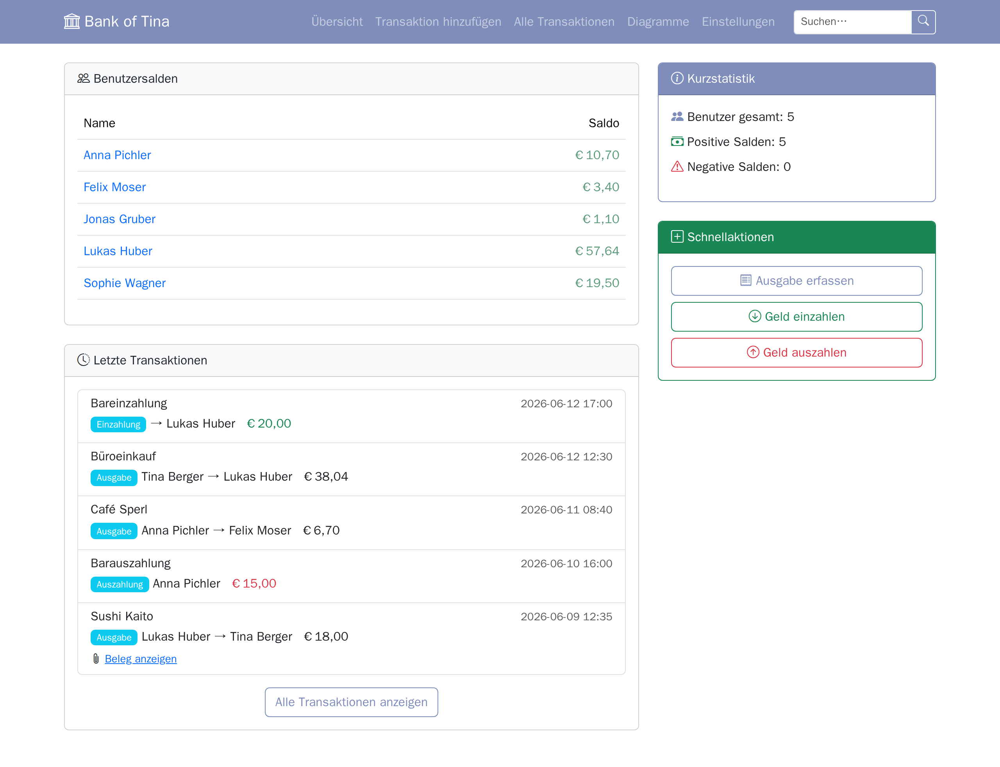
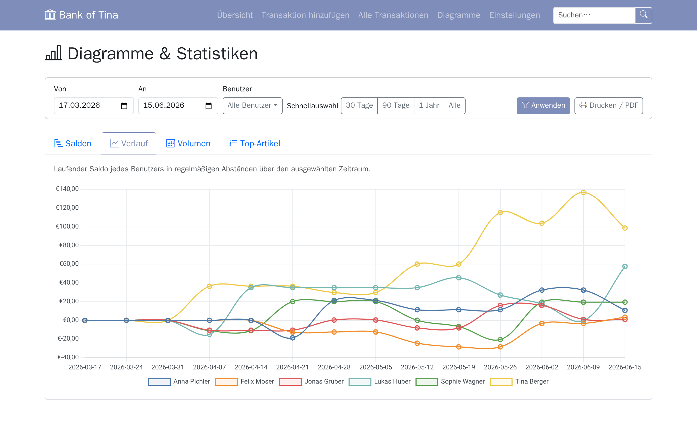
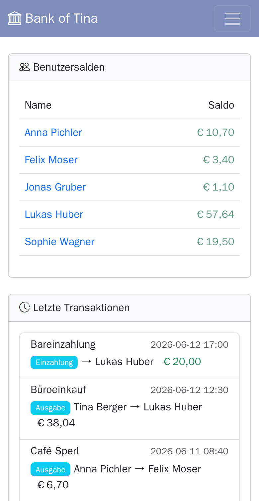
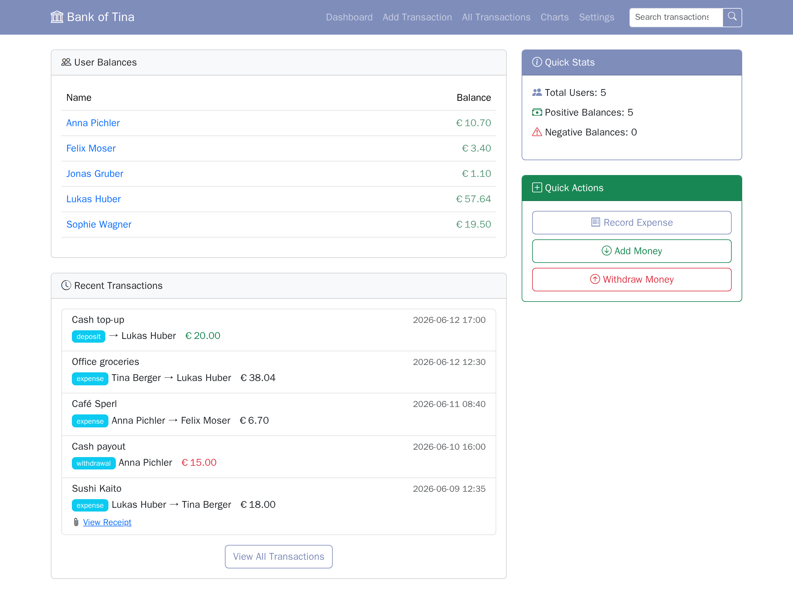
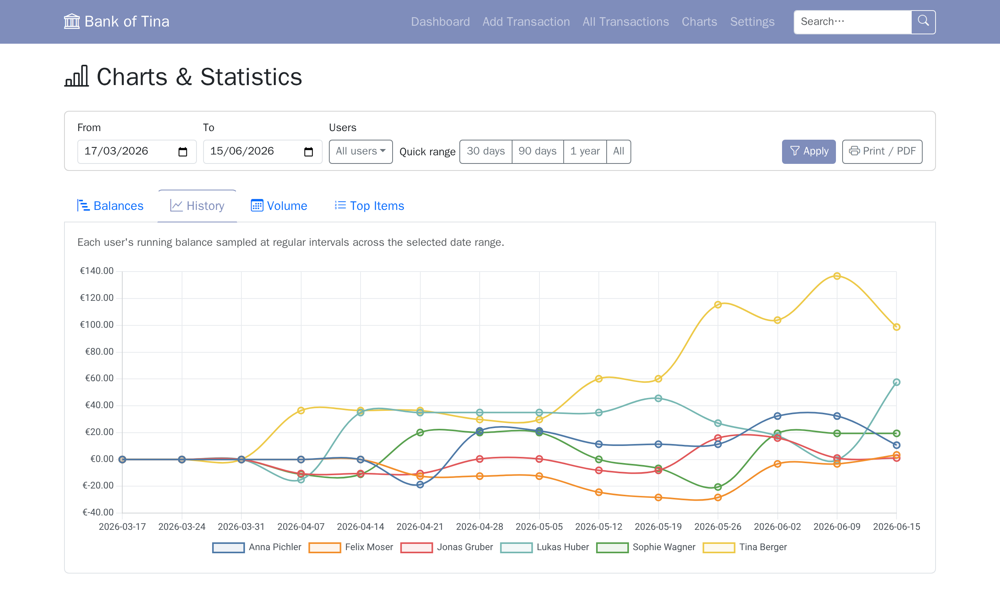
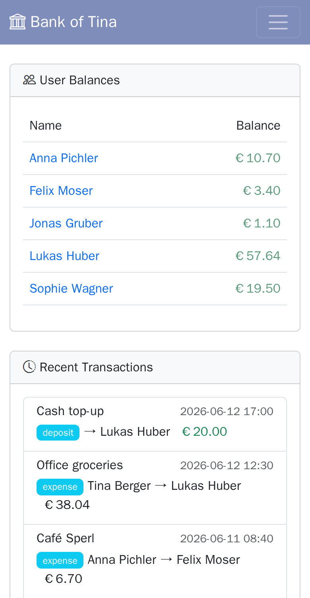

# 🏦 Bank of Tina

Eine selbst gehostete Webanwendung für gemeinsame Ausgaben und Salden in einem kleinen Büro oder einer Gruppe. Komplett zweisprachig (Deutsch und Englisch), gebaut mit Flask und MariaDB, läuft vollständig in Docker — keine externen Dienste erforderlich.



**Status:** einsatzbereit für ein vertrauenswürdiges Team. Die App hat keine Anmeldung, also nur hinter einem Reverse-Proxy mit Authentifizierung oder im vertrauenswürdigen LAN betreiben ([Schnellstart](#-schnellstart)).

- **Ausgaben mit Belegen**, Einzahlungen und Auszahlungen; Salden in Echtzeit
- **Wöchentliche Saldo-E-Mails** pro Benutzer und eine Admin-Zusammenfassung
- **Diagramme und Statistiken**, automatische **Backups**
- **Konfigurierbare Oberfläche** mit Designs und E-Mail-Vorlagen, alles in der Web-UI

Jede Seite mit einem Satz dazu: [Screenshot-Galerie](docs/screenshots/README.md). Schritt für Schritt: [Bedienungsanleitung](docs/manual.de.md).

> **🇬🇧 [English version below](#-english) / 🇩🇪 Deutsche Version zuerst**

**Inhalt:** [Funktionen](#-funktionen) · [Schnellstart](#-schnellstart) · [Bedienungsanleitung](#-bedienungsanleitung) · [Dateistruktur](#-dateistruktur) · [Sicherheit](#-sicherheitshinweise) · [Wartung](#-wartung) · [Fehlerbehebung](#-fehlerbehebung) · [Tests](#-tests-ausführen) · [Screenshots](#-screenshots) · [Zukunftsideen](#-zukunftsideen)

---

## ✨ Funktionen

### Benutzer & Salden
- **Teammitglieder** mit Name und E-Mail; der Saldo jedes Benutzers wird in Echtzeit geführt.
- **Deaktivieren**: deaktivierte Benutzer verschwinden von der Übersicht und bleiben in den Einstellungen verwaltbar.
- **Admin als „Bank"**: der Seiten-Admin (z. B. Tina) fehlt in der Saldotabelle der Übersicht und in der Admin-Zusammenfassung. Sie nimmt weiterhin ganz normal an Transaktionen teil (Dropdowns, Suche, Statistiken usw.).
- **Übersicht**: Name und Saldo; die E-Mail-Spalte ist optional (Einstellungen → Allgemein, standardmäßig aus).
- **Benutzerdetailseite**: Klick auf den Namen öffnet die paginierte Transaktionshistorie (20 pro Seite).
- **E-Mail-Einstellungen pro Benutzer**: wöchentliche Saldo-E-Mail ein/aus und wie viel Historie sie enthält (`Letzte 3`, `Diese Woche`, `Dieser Monat` oder `Keine`).

### Transaktionen
- **Ausgabe**: erfassen, wer bezahlt hat, und Artikel einzelnen Personen zuordnen.
- **Einzahlung / Auszahlung**: Geld zum Saldo eines Benutzers hinzufügen oder abziehen.
- **Bearbeiten**: Beschreibung, Notizen, Betrag, Datum, Von/An-Benutzer, Ausgabenpositionen und Beleg.
- **Löschen**: Salden werden automatisch zurückgesetzt.
- **Notizfeld**: optionaler Freitext für längeren Kontext; inline in allen Transaktionslisten angezeigt und in der Suche enthalten.
- **Monatsansicht**: nach Tag gruppiert, mit ◀ ▶ und einem Monat/Jahr-Schnellwähler; standardmäßig der aktuelle Monat.
- **Suche**: Volltext über Beschreibungen und Ausgabenpositionen, 25 Treffer pro Seite.
  - erweiterte Filter: Typ, Benutzer, Datumsbereich, Betragsbereich und „Hat Anhang / Beleg"
  - im Benutzerfilter erscheinen nur aktive Benutzer

### Ausgabenpositionen
- **Einzelpositionen** (Name + Preis) pro Ausgabe; bei gespeicherten Transaktionen bearbeiten, hinzufügen oder entfernen.
- **Leere Zeilen**: wie viele beim Öffnen des Transaktionsformulars vorausgefüllt sind, ist einstellbar.

### Häufige Autovervollständigung
- **Vorschläge** für Artikelnamen, Beschreibungen (in allen Beschreibungsfeldern) und Preise (in den Artikelpreisfeldern).
- **Globaler Schalter** für alle Vorschläge; eine **Blacklist** pro Typ verhindert, dass bestimmte Werte je automatisch gesammelt werden.
- **Auto-Sammlung**: optionaler geplanter Job, der Werte aus der Transaktionshistorie übernimmt, sobald sie einen Schwellenwert erreichen. Schalter und Schwellenwert gibt es je Typ.
- **Debug-Log**: im Debug-Modus landet jede Entscheidung (hinzugefügt/übersprungen/Zusammenfassung) in der Datenbank und in den Einstellungen; höchstens 500 Einträge.

### Belege
- **JPG, PNG oder PDF** beim Erfassen hochladen; später hochladen, ersetzen oder entfernen (die alte Datei wird automatisch gelöscht).
- **Ablage**: `uploads/JJJJ/MM/TT/KäuferName_dateiname_a1b2c3.ext`. Dateinamen werden bereinigt; ein Zufallssuffix verhindert, dass gleichnamige Uploads einander überschreiben.

### Backup & Wiederherstellung
- **Backup erstellen** auf Abruf oder nach Zeitplan (gleicher Tag/Uhrzeit-Wähler wie bei E-Mail und Auto-Sammlung).
- **Inhalt** einer `bot_backup_JJJJ_MM_TT_HH-mm-ss.tar.gz` (nur für den Besitzer lesbar, `0600`):
  - `dump.sql`: vollständiger MariaDB-Dump mit `DROP TABLE IF EXISTS`, auf Festplatte gestreamt (kein Speicherlimit)
  - `receipts/`: alle hochgeladenen Belege
  - `.env`: `SECRET_KEY` und Datenbank-Zugangsdaten aus den Umgebungsvariablen des Containers
- **Herunterladen** jedes Backups direkt im Browser.
- **Wiederherstellen** mit einem Klick:
  - zuerst wird automatisch ein Sicherheits-Backup des aktuellen Stands erstellt
  - dann die Datenbank (mit `mariadb --sandbox`), erst danach die Belege
  - anschließend laufen die Migrationen, und die Zeitpläne werden aus den wiederhergestellten Einstellungen neu geladen
- **Hochladen** von einer anderen Instanz: 5-MB-Blöcke mit Fortschrittsbalken, bis 2 GB; die Datei muss ein gültiges tar-Archiv sein.
- **Auto-Bereinigung**: wie viele Backups behalten werden, ist einstellbar; ältere werden nach jedem geplanten Lauf gelöscht.
- **Backup-Status-E-Mail** an den Seiten-Admin nach jedem *geplanten* Backup: Ergebnis, Dateiname, behaltene und bereinigte Backups. Manuelle Backups lösen sie nie aus.
- **Debug-Log**: im Debug-Modus wird jeder Backup-Schritt gespeichert und in den Einstellungen angezeigt.

### Diagramme & Statistiken
Eine eigene **Diagramme**-Seite (Navigationsleiste → Diagramme) mit einer gemeinsamen Filterleiste und vier Tabs:

| Tab | Diagrammtyp | Was angezeigt wird |
|-----|-------------|-------------------|
| **Salden** | Horizontaler Balken | Aktueller Saldo pro Benutzer; grün/rot je nach Vorzeichen; sortiert von höchstem zu niedrigstem |
| **Verlauf** | Mehrlinien | Laufender Saldo jedes Benutzers über die Zeit, aus dem Transaktionslog rekonstruiert; wöchentliche oder monatliche Datenpunkte je nach ausgewähltem Bereich |
| **Volumen** | Balken + Linie | Transaktionsanzahl (Balken, linke Achse) und Gesamtbetrag (Linie, rechte Achse) gruppiert nach Woche oder Monat |
| **Top-Artikel** | Horizontaler Balken | Top 15 Ausgabenpositionen nach Gesamtbetrag oder Anzahl; zwischen beiden Modi umschalten |

- **Filterleiste**: Datumsbereich, Schnellvorlagen (30 Tage / 90 Tage / 1 Jahr / Alle ab der ersten Transaktion), Mehrfachauswahl der Benutzer, Anwenden. Bereiche sind Kalendertage in der eingestellten Zeitzone.
- **Drucken / PDF**: druckt nur den aktiven Tab, A4 quer; das Diagramm wird vorher auf Seitengröße skaliert. Browser-Druckdialog → Als PDF speichern.



### 🌐 Mehrsprachigkeit (i18n)
- **Deutsch und Englisch**, app-weit umschaltbar unter Einstellungen → Allgemein → Sprache (in der Datenbank gespeichert). Standard ist Deutsch (`de`).
- **Vollständig übersetzt**: alle UI-Elemente, Flash-Nachrichten, E-Mail-Vorlagen, Diagrammbeschriftungen und Transaktionstyp-Badges; Monatsnamen und Tagesheader in der gewählten Sprache.
- **Flask-Babel** mit Standard-gettext-Dateien (`.po`/`.mo`).
- **Zahlenformat**: Dezimaltrennzeichen Punkt (`1.99`) oder Komma (`1,99`) und Währungssymbol (€, $, £, ¥ und mehr), ebenfalls unter Einstellungen → Allgemein.

### PWA — Zum Startbildschirm hinzufügen
- **Installieren** ohne App Store oder native Build-Tools:
  - Android Chrome: Drei-Punkt-Menü → „Zum Startbildschirm hinzufügen" (oder automatisches Installationsbanner)
  - iOS Safari: Teilen-Menü → „Zum Home-Bildschirm"; korrektes Icon, Name und Standalone-Start
- **Web App Manifest** dynamisch unter `/manifest.json`; `theme_color` folgt der Navigationsfarbe.
- **Service Worker** unter `/sw.js` (eine Flask-Route, damit er den ganzen App-Scope steuert; braucht HTTPS oder `localhost`):
  - behandelt nur Seitenaufrufe und holt immer aktuelle Daten
  - zeigt die übersetzte Offline-Seite (`/offline`) nur ohne Netzwerk; Serverantworten, auch Fehler, bleiben unverändert
- **Icons** in 32×32, 192×192 und 512×512 im Bind-Mount `./icons/` (überleben Rebuilds), beim ersten Start in der Standard-Designfarbe erzeugt. `/favicon.ico` liefert das 32-px-Icon.
- **App-Icon verwalten** unter Einstellungen → Vorlagen → App-Icon:
  - **Mit Navigationsfarbe neu generieren**: weiße Bank-Silhouette auf der aktuellen Designfarbe
  - **Benutzerdefiniertes Icon hochladen**: PNG oder JPG, automatisch auf die drei Größen skaliert
  - **Auf Standard zurücksetzen**: Standard-Icon in der Standard-Designfarbe (`#7f8dbb`)
  - Cache-Busting sorgt dafür, dass Browser und PWA neue Icons sofort übernehmen



### Oberfläche
- **Toast-Benachrichtigungen**: Bootstrap-5-Toasts oben rechts; verschwinden nach 4 Sekunden und stapeln sich bei mehreren Nachrichten.
- **Kein doppeltes Absenden**: nach dem Absenden sind die Buttons eines Formulars deaktiviert, ein Doppelklick erfasst nichts doppelt.
- **Skeleton-Loading**: die Diagrammseite zeigt pulsierende Platzhalter, solange die Daten laden (Balken für Salden/Top-Artikel, vollbreite Rechtecke für Verlauf/Volumen).

### Vorlagen & Design
- **Farbpalette**: Navigationsfarbe, E-Mail-Header-Farbverlauf (Anfang + Ende), positive und negative Saldofarbe; jede mit Farbwähler und Hex-Textfeld.
- **Vordefinierte Designs**: Standard, Klassisch, Ozean, Wald, Sonnenuntergang oder Schiefer. Ein Preset füllt sofort alle Wähler; eine manuelle Änderung wechselt zu „Benutzerdefiniert".
- **E-Mail-Betreffs und -Texte** für alle drei E-Mail-Typen, **pro Sprache gespeichert**. Ein leeres Feld lässt die Zeile weg.
  - wöchentliche Saldo-E-Mail: Begrüßung, Einleitung, Fußzeile 1 und Fußzeile 2
  - Admin-Zusammenfassung: Einleitung und Fußzeile; Schalter „E-Mail-Adressen in der Zusammenfassungstabelle anzeigen" (Standard aus)
  - Backup-Status-E-Mail: Fußzeile
- **Platzhalter** werden beim Senden ersetzt:

  | Platzhalter | Verfügbar in |
  |-------------|-------------|
  | `[Name]` | Wöchentliche E-Mail Betreff & Text |
  | `[Balance]` | Wöchentliche E-Mail Text |
  | `[BalanceStatus]` | Wöchentliche E-Mail Text |
  | `[Date]` | Alle drei E-Mail-Betreffs & -Texte |
  | `[UserCount]` | Admin-Zusammenfassung Betreff & Text |
  | `[BackupStatus]` | Backup-Status-E-Mail Betreff |

- **Live-Vorschau**: der **Vorschau**-Button jeder Vorlagenkarte öffnet das gerenderte HTML in einem neuen Tab, mit echten Daten (oder Beispieldaten, wenn keine Benutzer existieren).
- Alle Design- und Vorlageneinstellungen liegen in der Datenbank und gelten sofort, ohne Neustart.

### Einstellungen (Web-UI — kein `.env`-Bearbeiten nötig)
Sechs Tabs: **Allgemein**, **E-Mail**, **Häufige**, **Backup**, **Vorlagen** und **Benutzer**. Was jeder Tab einstellt: [Einstellungen im Überblick](docs/manual.de.md#einstellungen-im-überblick).

### E-Mail-Benachrichtigungen
- **SMTP-Zugangsdaten** liegen in der Datenbank (Einstellungen → E-Mail).
- **Verschlüsselung**: STARTTLS (meist Port 587), SSL/TLS (Port 465 ist immer SSL/TLS) oder keine. Server-Zertifikate werden immer geprüft; ein Versandlauf nutzt eine einzige SMTP-Verbindung.
- **Absender**: eine Absenderadresse bei `example.com`, `.local` oder ohne Punkt in der Domain wird beim Versand abgelehnt. Im EHLO meldet sich die App mit der Domain der Absenderadresse (das Feld **EHLO-Name** ändert das). Jede Mail hat einen Text- und einen HTML-Teil.
- **Jetzt senden** schickt allen aktiven Benutzern sofort ihren aktuellen Saldo.
- **Automatischer Zeitplan**: Tag und Uhrzeit (24-Stunden-Format); der Zeitplan überlebt Container-Neustarts.
- **Opt-in pro Benutzer**: abgemeldete Benutzer werden bei jedem Versand übersprungen (manuell und geplant). Mit einer **Seiten-URL** (Einstellungen → E-Mail) trägt die wöchentliche Mail einen Abbestell-Link und `List-Unsubscribe` (Ein-Klick-Abbestellen im Mailprogramm); hinter einem Reverse-Proxy mit Anmeldung muss `/unsubscribe/` ohne Anmeldung erreichbar sein.
- **Transaktionsumfang pro Benutzer**: letzte 3 Transaktionen, alle dieser Woche, alle dieses Monats oder keine Historie.
- **Admin-Zusammenfassung**: optional an den Seiten-Admin (Einstellungen → Allgemein), mit farbcodierter Saldenübersicht *aller* aktiven Benutzer, unabhängig vom Opt-in.
- **E-Mail-Log**: fehlgeschlagene Sendungen immer, erfolgreiche nur im Debug-Modus.

---

## 🚀 Schnellstart

Voraussetzung: Docker und Docker Compose (Plugin `docker compose` oder eigenständiges `docker-compose`).

**1. Repository klonen und Umgebungsdatei anlegen**
```bash
git clone https://github.com/phoen-ix/bank-of-tina.git
cd bank-of-tina
cp .env.example .env
```

**2. `.env` bearbeiten**: einen starken `SECRET_KEY` setzen und die Beispiel-Passwörter (`DB_PASSWORD`, `DB_ROOT_PASSWORD`) vor dem ersten Start ändern.
```bash
# Secret Key generieren mit:
python3 -c "import secrets; print(secrets.token_hex(32))"
```
`docker compose` verweigert den Start, wenn `SECRET_KEY` oder die Passwörter fehlen, und die App startet nicht mit dem Beispiel-`SECRET_KEY`. Alle Variablen sind in `.env.example` kommentiert.

**3. Starten und `http://localhost:5000` öffnen**
```bash
docker compose up -d
```

SMTP-Zugangsdaten und der E-Mail-Zeitplan werden danach in der App unter **Einstellungen** konfiguriert, ohne Neustart.

### Zugriff von anderen Rechnern
Die App hat **keine Anmeldung**. Deshalb wird Port 5000 standardmäßig nur auf `127.0.0.1` veröffentlicht, also nur vom Docker-Host aus erreichbar.
- **Empfohlen:** einen Reverse-Proxy mit Authentifizierung (nginx, Caddy, …) davorschalten und `BEHIND_PROXY=1` in `.env` setzen, damit Rate-Limits die echten Client-Adressen sehen.
- **Nur im vertrauenswürdigen LAN:** `BIND_ADDRESS=0.0.0.0` in `.env` setzen und `http://dein-server-ip:5000` öffnen. Jeder im Netzwerk kann dann alle Daten sehen und ändern, auch Backups (inkl. Zugangsdaten) herunterladen.

---

## 📱 Bedienungsanleitung

Die häufigsten Aufgaben Schritt für Schritt mit Screenshots, von „Benutzer hinzufügen" bis „Sprache wechseln", plus alle Einstellungs-Tabs: [docs/manual.de.md](docs/manual.de.md).

---

## 🗂️ Dateistruktur

```
bank-of-tina/
├── app/
│   ├── app.py                    # Einstiegspunkt: Flask-App erstellen, Extensions initialisieren, Scheduler starten
│   ├── extensions.py             # Gemeinsame Instanzen: db, csrf, migrate, limiter, scheduler, babel
│   ├── config.py                 # Konstanten (THEMES, TEMPLATE_DEFAULTS[_DE], CURRENCIES, CRON_DAYS, BACKUP_DIR, …) und db_env()
│   ├── models.py                 # Alle SQLAlchemy-Modelle (vollständig typ-annotiert)
│   ├── helpers.py                # Hilfsfunktionen: parse_amount, fmt_amount, save_receipt, path_inside, etc.
│   ├── email_service.py          # E-Mail-Erstellung und -Versand (Saldo, Admin-Zusammenfassung, Backup-Status)
│   ├── backup_service.py         # Backup, Wiederherstellung, Upload-Zusammenbau, Bereinigung, Status-E-Mail
│   ├── scheduler_jobs.py         # APScheduler-Job-Einrichtung und -Wiederherstellung
│   ├── translations/             # Gettext-Übersetzungsdateien (Babel)
│   │   ├── de/LC_MESSAGES/       # Deutsche Übersetzungen (.po + .mo)
│   │   └── en/LC_MESSAGES/       # Englische Übersetzungen (.po + .mo)
│   ├── migrations/               # Alembic-Migrationen (Flask-Migrate)
│   ├── routes/
│   │   ├── __init__.py           # register_blueprints(app)
│   │   ├── main.py               # main_bp: Health, Übersicht, Benutzer, Transaktionen, Suche, Belege, PWA
│   │   ├── settings.py           # settings_bp: alle Einstellungen, häufige Artikel, Backup, Vorlagen, Icons
│   │   └── analytics.py          # analytics_bp: Diagrammseite + Datenendpunkt
│   ├── templates/                # Jinja2-Vorlagen (alle mit {{ _('...') }} internationalisiert; offline.html = Offline-Seite)
│   └── static/
│       ├── sw.js                 # Service Worker (Offline-Seite nur bei Netzwerkausfall)
│       ├── js/money.js           # Betragsparser der Ausgabenformulare (wie parse_amount im Backend)
│       └── vendor/               # Selbst gehostete Frontend-Abhängigkeiten (kein CDN)
├── tests/                        # pytest-Suite (SQLite in-memory, kein CSRF, make_user-Factory)
├── e2e/                          # Playwright (eigenes Node-Paket): E2E-Suite tests/ + COVERAGE.md, Screenshot-Tour docs/
├── scripts/e2e.sh                # E2E-Suite gegen einen Wegwerf-Stack (App, MariaDB, Mailpit)
├── scripts/docs-screenshots.sh   # Screenshots neu erzeugen (Wegwerf-Stack pro Sprache)
├── docs/                         # Bedienungsanleitung (manual.de.md, manual.md), screenshots/ (Galerie) und history.md
├── docker/
│   ├── requirements.txt          # Python-Abhängigkeiten (Laufzeit)
│   ├── requirements-dev.txt      # + Testabhängigkeiten
│   └── entrypoint.sh             # Docker-Entrypoint: Bind-Mount-Rechte und Benutzer-Switch
├── uploads/                      # Belege — als JJJJ/MM/TT/ organisiert (Bind-Mount)
├── backups/                      # Backup-Archive (Bind-Mount)
├── icons/                        # PWA-Icons (Bind-Mount; beim ersten Start automatisch generiert)
├── mariadb-data/                 # MariaDB-Datenverzeichnis (Bind-Mount)
├── Dockerfile
├── docker-compose.yml
├── docker-compose.e2e.yml        # Overlay für E2E-Suite und Screenshot-Tour (eigene Container-Namen, benannte Volumes, Mailpit)
└── .env.example
```

---

## 🔒 Sicherheitshinweise

- **Keine Anmeldung**: jeder, der Port 5000 erreicht, kann alles sehen und ändern, auch Backups herunterladen (sie enthalten `SECRET_KEY` und Datenbank-Passwörter) oder einspielen. Deshalb ist der Port standardmäßig nur auf `127.0.0.1` veröffentlicht; siehe [Schnellstart](#zugriff-von-anderen-rechnern).
- **Content Security Policy**: jede HTML-Antwort enthält einen Nonce-basierten CSP-Header:
  - `script-src 'self' 'nonce-…'`; `style-src 'self' 'unsafe-inline'`; `frame-ancestors 'none'`; `object-src 'none'`
  - alle Event-Handler laufen über `addEventListener` / Event-Delegation, Skripte brauchen also kein `'unsafe-inline'`
- **HTML-Injection-Prävention**: alle benutzergesteuerten Werte (Namen, E-Mails, Beschreibungen, Währungssymbol, Fehlermeldungen) werden mit `html.escape()` escapt, bevor sie in HTML-E-Mail-Vorlagen landen.
- **Keine Benutzerdaten in JavaScript**: Namen und andere Werte werden nur als escapter HTML-Text gerendert (z. B. in `<template>`-Elementen) oder über `|tojson` übergeben.
- **Sichere Wiederherstellung**:
  - nur `dump.sql` und `receipts/` werden entpackt, mit Pythons tar-Filter `data` (lehnt Links nach außen, Gerätedateien, absolute Pfade und `..` ab)
  - der Dump wird mit `mariadb --sandbox` eingespielt, ein manipuliertes Backup kann also keine Shell-Befehle ausführen
  - das Datenbank-Passwort wird per Umgebungsvariable statt auf der Kommandozeile übergeben
- **Dateipfade aus Anfragen**: Backup-Namen, Upload-IDs und Beleg-Endungen werden exakt geprüft, und jeder daraus gebaute Pfad muss im Backup- bzw. Upload-Ordner bleiben.
- **Rücksprung nur auf die eigene Seite**: nach einer Aktion leitet die App nur auf einen Referrer desselben Hosts zurück.
- **Sichere Suchabfragen**: SQL-Wildcards (`%`, `_`) in Benutzereingaben werden escapt, bevor ILIKE-Muster entstehen.
- **SMTP**: Server-Zertifikate werden immer geprüft; Verbindungen verwenden ein 30-Sekunden-Timeout.
- **Container**: startet als Root nur, um die Rechte der Bind-Mount-Verzeichnisse zu korrigieren, und wechselt sofort via `gosu` zu `appuser` (UID 1000). Der App-Code gehört Root; der Prozess kann nur in `uploads/`, `backups/` und die Icons schreiben.
- **Rate-Limiting** pro Route auf schreibintensiven Endpunkten.
- **Betrieb**:
  - einen starken, zufälligen `SECRET_KEY` in der `.env`-Datei setzen und die `.env` niemals committen (sie ist in `.gitignore`)
  - für Gmail ein **App-Passwort** statt des Hauptkonto-Passworts verwenden
  - für Zugriff von anderen Rechnern einen Reverse-Proxy (nginx, Caddy) mit Authentifizierung davorschalten (`BEHIND_PROXY=1`)

---

## 🔧 Wartung

MariaDB-Upgrade, Health-Check (`/health`), Logs, manueller Datenbank-Dump, Aktualisieren und Zurücksetzen: [Bedienungsanleitung → Betrieb & Wartung](docs/manual.de.md#betrieb--wartung).

---

## 🐛 Fehlerbehebung

E-Mail-Versand, Beleg-Upload, belegter Port, Zugriff von anderen Rechnern, Start von Web- und DB-Container: [Bedienungsanleitung → Fehlerbehebung](docs/manual.de.md#fehlerbehebung).

---

## 🧪 Tests ausführen

Tests verwenden eine SQLite-In-Memory-Datenbank und benötigen keine laufenden Dienste:

```bash
pip install -r docker/requirements-dev.txt
FLASK_TESTING=1 python -m pytest tests/ -v
```

Die Tests decken Hilfsfunktionen, Modelle, Routen, Einstellungen, Diagramme, Health-Check, E-Mail-Erstellung und -Versand, Backup/Restore, Salden und Zeitzonen, Eingabeprüfung, gerenderte Seiten und Internationalisierung ab. Wie viele es sind: `python -m pytest --collect-only -q | tail -1`.

### E2E

Die Playwright-Suite in `e2e/tests/` bedient jede Seite und jede Funktion im Browser (Inventar: [`e2e/COVERAGE.md`](e2e/COVERAGE.md)).
- `scripts/e2e.sh` baut das Produktions-Image und startet App, MariaDB und Mailpit als Wegwerf-Stack unter dem Projektnamen `bank-of-tina_e2e` (nie auf `./mariadb-data`).
- Danach räumt das Skript alles weg.

```bash
cd e2e && npm ci && npx playwright install chromium && cd ..
scripts/e2e.sh                         # PORT_BASE=5000 ist der Standard, Mailpit auf PORT_BASE+5
scripts/e2e.sh tests/search.spec.ts    # weitere Argumente gehen an `playwright test`
```

---

## 📸 Screenshots

Alle Bilder in diesem README und in der Bedienungsanleitung stammen aus einer automatischen Tour (Playwright, `e2e/docs/`), die eine Demo-Büro-Belegschaft über die Weboberfläche anlegt und jede Seite in beiden Sprachen fotografiert. Übersicht aller Bilder: [`docs/screenshots/`](docs/screenshots/README.md).

Neu erzeugen (braucht Docker und Node; startet für jede Sprache einen Wegwerf-Stack unter dem Projektnamen `bank-of-tina_docs`, nie auf `./mariadb-data`):

```bash
cd e2e && npm ci && npx playwright install chromium && cd ..
scripts/docs-screenshots.sh            # schreibt docs/screenshots/*.png; PORT_BASE=5000 ist der Standard
oxipng -o 4 --strip safe docs/screenshots/*.png   # vor dem Commit: hält das 6-MB-Budget ein
```

---

## 💡 Zukunftsideen

- [ ] CSV-/Excel-Export von Transaktionen
- [ ] Benutzerauthentifizierung und Login-System
- [ ] Wechselkurs-bewusste Mehrwährungsunterstützung (Währungssymbol ist bereits konfigurierbar)
- [ ] OCR für automatische Belegerfassung
- [ ] Gespeicherte/angeheftete Suchen

---

Entwickelt mit ❤️ um Büro-Mittagessen einfacher zu machen! 🥗

---
---

# 🇬🇧 English

A self-hosted web application for tracking shared expenses and balances within a small office or group. Fully bilingual (German and English), built with Flask and MariaDB, runs entirely in Docker — no external services required.



**Status:** ready for a trusted team. The app has no login, so run it behind an authenticating reverse proxy or on a trusted LAN only ([Quick Start](#-quick-start)).

- **Expenses with receipts**, deposits and withdrawals; real-time balances
- **Weekly balance emails** per user and an admin summary
- **Charts and statistics**, automated **backups**
- **Configurable UI** with themes and email templates, all in the web UI

Every screen with a sentence each: [screenshot gallery](docs/screenshots/README.md). Step by step: [Usage Guide](docs/manual.md).

**Contents:** [Features](#-features) · [Quick Start](#-quick-start) · [Usage Guide](#-usage-guide) · [Security](#-security-notes) · [Maintenance](#-maintenance) · [Troubleshooting](#-troubleshooting) · [Tests](#-running-tests) · [Screenshots](#-screenshots-1) · [Future Ideas](#-future-ideas)

---

## ✨ Features

### Users & Balances
- **Team members** with name and email; every user's balance is tracked in real time.
- **Deactivate**: deactivated users are hidden from the dashboard and stay manageable from Settings.
- **Admin as the "bank"**: the site admin (e.g. Tina) is left out of the dashboard balance table and the admin summary email. She still participates in transactions normally (dropdowns, search, analytics, etc.).
- **Dashboard**: name and balance; the email column is optional (Settings → General, default off).
- **User detail page**: click a user's name to open their paginated transaction history (20 per page).
- **Per-user email preferences**: weekly balance email on/off and how much history it includes (`Last 3`, `This week`, `This month`, or `None`).

### Transactions
- **Expense**: record who paid and assign items to individuals.
- **Deposit / Withdrawal**: add money to or deduct money from a user's balance.
- **Edit**: description, notes, amount, date, from/to user, expense items, and receipt.
- **Delete**: balances are reversed automatically.
- **Notes field**: optional free text for longer context or justification; shown inline on all transaction lists and included in search.
- **Month-by-month view**: grouped by day, with ◀ ▶ navigation and a month/year jump picker; defaults to the current month.
- **Search**: free text across descriptions and expense items, 25 results per page.
  - advanced filters: type, user, date range, amount range, and a "Has attachment / receipt" toggle
  - only active users appear in the user filter

### Expense Items
- **Line items** (name + price) per expense; edit, add, or remove them on saved transactions.
- **Blank rows**: how many are pre-filled when the Add Transaction form opens is configurable.

### Common Autocomplete
- **Suggestions** for item names, descriptions (on all description fields), and prices (on expense item price fields).
- **Global toggle** for all autocomplete; a per-type **blacklist** keeps specific values from ever being auto-collected.
- **Auto-collect**: optional scheduled job that promotes values from the transaction history once they reach a threshold. Each type has its own switch and threshold.
- **Debug log**: in debug mode every decision (added / skipped / summary) is written to the database and shown in Settings; capped at 500 entries.

### Receipts
- **JPG, PNG, or PDF** when recording a transaction; upload, replace, or remove one later (the old file is deleted from disk automatically).
- **Storage**: `uploads/YYYY/MM/DD/BuyerName_filename_a1b2c3.ext`. Filenames are sanitised; a random suffix keeps same-named uploads from overwriting each other.

### Backup & Restore
- **Create backup** on demand or on a recurring schedule (same day/time picker as email and auto-collect).
- **Contents** of a `bot_backup_YYYY_MM_DD_HH-mm-ss.tar.gz` (owner-readable only, `0600`):
  - `dump.sql`: full MariaDB dump with `DROP TABLE IF EXISTS`, streamed to disk (no memory limit)
  - `receipts/`: every uploaded receipt
  - `.env`: `SECRET_KEY` and database credentials from the container's environment variables
- **Download** any backup directly from the browser.
- **Restore** with one click:
  - a safety backup of the current state is created first
  - then the database is restored (with `mariadb --sandbox`), and only then the receipts
  - afterwards migrations run and the schedules are reloaded from the restored settings
- **Upload** a backup from another instance: 5 MB chunks with a progress bar, up to 2 GB; the result must be a valid tar archive.
- **Auto-prune**: configure how many backups to keep; older ones are deleted after each scheduled run.
- **Backup status email** to the site admin after each *scheduled* backup: result, filename, backups kept, and number pruned. Manual backups never trigger it.
- **Debug log**: in debug mode every backup step is written to the database and shown in Settings.

### Charts & Statistics
A dedicated **Charts** page (nav bar → Charts) with a shared filter bar and four tabs:

| Tab | Chart type | What it shows |
|-----|-----------|---------------|
| **Balances** | Horizontal bar | Current balance per user; green/red per sign; sorted highest → lowest |
| **History** | Multi-line | Each user's running balance over time, reconstructed from the transaction log; weekly or monthly sample points depending on the selected range |
| **Volume** | Bar + line combo | Transaction count (bars, left axis) and total amount (line, right axis) grouped by week or month |
| **Top Items** | Horizontal bar | Top 15 expense line items by total amount or count; toggle between the two modes |

- **Filter bar**: date range pickers, quick presets (30 days / 90 days / 1 year / All from the first transaction), multi-select user dropdown, Apply. Ranges are calendar days in the configured timezone.
- **Print / PDF**: prints only the active tab, A4 landscape; the chart is resized to fill the page first. Browser print dialog → Save as PDF.



### 🌐 Internationalization (i18n)
- **German and English**, switchable app-wide via Settings → General → Language (stored in the database). The default is German (`de`).
- **Full coverage**: all UI elements, flash messages, email templates, chart labels, and transaction type badges; month names and day headers in the selected language.
- **Flask-Babel** with standard gettext `.po`/`.mo` files.
- **Number format**: decimal separator period (`1.99`) or comma (`1,99`) and currency symbol (€, $, £, ¥, and more), also under Settings → General.

### PWA — Install to Home Screen
- **Install** without an App Store or native build tools:
  - Android Chrome: three-dot menu → "Add to home screen" (or the automatic install banner)
  - iOS Safari: Share sheet → "Add to Home Screen"; correct icon, name, and standalone launch
- **Web App Manifest** served dynamically at `/manifest.json`; `theme_color` tracks the navbar color.
- **Service worker** at `/sw.js` (a Flask route, so it controls the entire app scope; needs HTTPS or `localhost`):
  - handles page navigations only and always fetches fresh data
  - shows the translated offline page (`/offline`) only when the network is down; server responses, errors included, are shown as-is
- **Icons** at 32×32, 192×192, and 512×512 in the `./icons/` bind mount (they survive rebuilds), generated in the default theme color on first run. `/favicon.ico` serves the 32px icon.
- **Manage the app icon** under Settings → Templates → App Icon:
  - **Regenerate with Navbar Color**: white bank silhouette on the current theme color
  - **Upload custom icon**: any PNG or JPG, resized to the three sizes automatically
  - **Reset to Default**: the default icon in the default theme color (`#7f8dbb`)
  - cache-busting makes browsers and the PWA pick up new icons immediately



### UI
- **Toast notifications**: Bootstrap 5 toasts in the top-right corner; they auto-hide after 4 seconds and stack when several fire at once.
- **No double submits**: once a form is submitted its buttons are disabled, so a double click can't record anything twice.
- **Skeleton loading**: the Charts page shows pulsing placeholders while data loads (bars for Balances/Top Items, full-width rectangles for History/Volume).

### Templates & Theming
- **Color palette**: navbar color, email header gradient (start + end), positive and negative balance colors; each with a color picker and a hex text field.
- **Preset themes**: Default, Classic, Ocean, Forest, Sunset, or Slate. A preset fills all pickers instantly; changing any picker by hand switches to "Custom".
- **Email subjects and bodies** for all three email types, **stored per language**. Leave a field blank to omit that line.
  - weekly balance email: greeting, intro, footer line 1, and footer line 2
  - admin summary: intro and footer; an "Include email addresses in summary table" switch (default off)
  - backup status email: footer
- **Placeholders** are substituted at send time:

  | Placeholder | Available in |
  |-------------|--------------|
  | `[Name]` | Weekly email subject & body |
  | `[Balance]` | Weekly email body |
  | `[BalanceStatus]` | Weekly email body |
  | `[Date]` | All three email subjects & bodies |
  | `[UserCount]` | Admin summary subject & body |
  | `[BackupStatus]` | Backup status email subject |

- **Live preview**: each template card's **Preview** button opens the rendered HTML in a new tab, using real data (or sample data when no users exist).
- All theme and template settings are stored in the database and apply immediately, with no restart.

### Settings (web UI — no `.env` editing needed)
Six tabs: **General**, **Email**, **Common**, **Backup**, **Templates**, and **Users**. What each one configures: [Settings at a Glance](docs/manual.md#settings-at-a-glance).

### Email Notifications
- **SMTP credentials** are stored in the database (Settings → Email).
- **Encryption**: STARTTLS (usually port 587), SSL/TLS (port 465 is always SSL/TLS) or none. Server certificates are always verified; one SMTP connection is used per send run.
- **Sender**: a From address at `example.com`, `.local` or a domain without a dot is refused at send time. The app gives the From domain in EHLO (the **EHLO Name** field overrides it). Every mail has a text and an HTML part.
- **Send Now** emails all active users their current balance immediately.
- **Auto-schedule**: pick a day and time (24 h clock); the schedule survives container restarts.
- **Per-user opt-in**: opted-out users are skipped on every send (manual and scheduled). With a **Site URL** (Settings → Email) the weekly email carries an unsubscribe link and `List-Unsubscribe` (one-click unsubscribe in the mail client); behind an authenticating reverse proxy, let `/unsubscribe/` through without login.
- **Per-user transaction scope**: last 3 transactions, all this week, all this month, or no history at all.
- **Admin summary email**: optional, to the site admin (Settings → General), with a colour-coded balance overview of *all* active users, regardless of opt-in.
- **Email log**: failed sends always, successful ones only in debug mode.

---

## 🚀 Quick Start

Prerequisite: Docker and Docker Compose (plugin `docker compose` or standalone `docker-compose`).

**1. Clone the repository and create your environment file**
```bash
git clone https://github.com/phoen-ix/bank-of-tina.git
cd bank-of-tina
cp .env.example .env
```

**2. Edit `.env`**: set a strong `SECRET_KEY` and change the example passwords (`DB_PASSWORD`, `DB_ROOT_PASSWORD`) before the first start.
```bash
# Generate a secret key with:
python3 -c "import secrets; print(secrets.token_hex(32))"
```
`docker compose` refuses to start when `SECRET_KEY` or the passwords are missing, and the app refuses the example `SECRET_KEY`. Every variable is commented in `.env.example`.

**3. Start it and open `http://localhost:5000`**
```bash
docker compose up -d
```

SMTP credentials and the email schedule are then configured inside the app under **Settings**, with no restart.

### Access from other machines
The app has **no login**. That's why port 5000 is published on `127.0.0.1` by default, i.e. reachable from the Docker host only.
- **Recommended:** put an authenticating reverse proxy (nginx, Caddy, …) in front and set `BEHIND_PROXY=1` in `.env` so rate limits see the real client addresses.
- **Trusted LAN only:** set `BIND_ADDRESS=0.0.0.0` in `.env` and open `http://your-server-ip:5000`. Everyone on the network can then see and change all data, including downloading backups (which contain credentials).

---

## 📱 Usage Guide

The common tasks step by step with screenshots, from "Adding Users" to "Switching Language", plus every Settings tab: [docs/manual.md](docs/manual.md).

---

## 🔒 Security Notes

- **No login**: anyone who can reach port 5000 can see and change everything, including downloading backups (they contain `SECRET_KEY` and the database passwords) or restoring one. That's why the port is published on `127.0.0.1` by default; see [Quick Start](#access-from-other-machines).
- **Content Security Policy**: every HTML response includes a nonce-based CSP header:
  - `script-src 'self' 'nonce-…'`; `style-src 'self' 'unsafe-inline'`; `frame-ancestors 'none'`; `object-src 'none'`
  - all event handlers use `addEventListener` / event delegation, so scripts need no `'unsafe-inline'`
- **HTML injection prevention**: all user-controlled values (names, emails, descriptions, currency symbol, error messages) are escaped with `html.escape()` before insertion into HTML email templates.
- **No user data in JavaScript**: names and other values are only rendered as escaped HTML text (e.g. inside `<template>` elements) or passed through `|tojson`.
- **Safe restore**:
  - only `dump.sql` and `receipts/` are extracted, using Python's `data` tar filter (rejects links pointing outside, device files, absolute paths and `..`)
  - the dump is loaded with `mariadb --sandbox`, so a crafted backup can't run shell commands
  - the database password is passed via the environment, not the command line
- **File paths from requests**: backup names, upload IDs, and receipt extensions are matched exactly, and every path built from them must stay inside the backup or upload folder.
- **Redirects stay on site**: after an action the app only redirects back to a referrer on the same host.
- **Safe search queries**: SQL wildcards (`%`, `_`) in user search input are escaped before building ILIKE patterns.
- **SMTP**: server certificates are always verified; connections use a 30-second timeout.
- **Container**: starts as root only to fix bind-mount directory ownership, then immediately drops to `appuser` (UID 1000) via `gosu`. The app code is owned by root, so the process can only write to `uploads/`, `backups/` and the icons.
- **Rate limiting** per route on write-heavy endpoints (user add, transaction add, send-now, backup create/restore).
- **Operations**:
  - set a strong, random `SECRET_KEY` in your `.env` file and never commit it (it is in `.gitignore`)
  - use an **App Password** for Gmail rather than your main account password
  - for access from other machines, put a reverse proxy (nginx, Caddy) with authentication in front (`BEHIND_PROXY=1`)
  - back up the `mariadb-data/` directory regularly, or use the built-in **Backup** feature (Settings → Backup tab)

---

## 🔧 Maintenance

MariaDB upgrades, the health check (`/health`), logs, a manual database dump, updating and resetting: [Usage Guide → Operations & Maintenance](docs/manual.md#operations--maintenance).

---

## 🐛 Troubleshooting

Email sending, receipt uploads, a busy port, access from other machines, web and DB container start-up: [Usage Guide → Troubleshooting](docs/manual.md#troubleshooting).

---

## 🧪 Running Tests

Tests use an in-memory SQLite database and require no running services:

```bash
pip install -r docker/requirements-dev.txt
FLASK_TESTING=1 python -m pytest tests/ -v
```

The tests cover helpers, models, routes, settings, analytics, health check, email building and sending, backup/restore, balances and timezones, input validation, rendered pages, and internationalization. To count them: `python -m pytest --collect-only -q | tail -1`.

### E2E

The Playwright suite in `e2e/tests/` drives every page and feature in a browser (inventory: [`e2e/COVERAGE.md`](e2e/COVERAGE.md)).
- `scripts/e2e.sh` builds the production image and starts the app, MariaDB and Mailpit as a throwaway stack under the project name `bank-of-tina_e2e` (never on `./mariadb-data`).
- Afterwards it removes it all.

```bash
cd e2e && npm ci && npx playwright install chromium && cd ..
scripts/e2e.sh                         # PORT_BASE=5000 is the default, Mailpit on PORT_BASE+5
scripts/e2e.sh tests/search.spec.ts    # extra arguments go to `playwright test`
```

---

## 📸 Screenshots

Every image in this README and in the Usage Guide comes from an automated tour (Playwright, `e2e/docs/`) that seeds a demo office through the web UI and photographs every screen in both languages. Gallery: [`docs/screenshots/`](docs/screenshots/README.md).

To regenerate (needs Docker and Node; starts a throwaway stack per language under the project name `bank-of-tina_docs`, never on `./mariadb-data`):

```bash
cd e2e && npm ci && npx playwright install chromium && cd ..
scripts/docs-screenshots.sh            # writes docs/screenshots/*.png; PORT_BASE=5000 is the default
oxipng -o 4 --strip safe docs/screenshots/*.png   # before committing: keeps the folder under 6 MB
```

---

## 💡 Future Ideas

- [ ] CSV / Excel export of transactions
- [ ] User authentication and login system
- [ ] Exchange-rate-aware multi-currency support (currency symbol is already configurable)
- [ ] OCR for automatic receipt parsing
- [ ] Saved/pinned searches

---

Made with ❤️ to make office lunches easier! 🥗
