# 📱 Bank of Tina — Bedienungsanleitung

Die häufigsten Aufgaben Schritt für Schritt, alle Einstellungs-Tabs im Überblick, Betrieb, Wartung und Fehlerbehebung. Installation und Funktionsübersicht: [README](../README.md). [English version](manual.md).

**Inhalt:** [Benutzer hinzufügen](#benutzer-hinzufügen) · [Ausgabe erfassen](#ausgabe-erfassen) · [Einzahlung oder Auszahlung](#einzahlung-oder-auszahlung-erfassen) · [Nach Monat durchblättern](#transaktionen-nach-monat-durchblättern) · [Suchen](#transaktionen-suchen) · [Bearbeiten](#transaktion-bearbeiten) · [Löschen](#transaktion-löschen) · [E-Mail einrichten](#e-mail-einrichten) · [E-Mail-Vorlagen](#e-mail-vorlagen-anpassen) · [Backup erstellen](#backup-erstellen) · [Backup wiederherstellen](#backup-wiederherstellen) · [Benutzer verwalten](#benutzer-verwalten) · [Sprache wechseln](#sprache-wechseln) · [Einstellungen im Überblick](#einstellungen-im-überblick) · [Betrieb & Wartung](#betrieb--wartung) · [Fehlerbehebung](#fehlerbehebung)

## Benutzer hinzufügen
1. **Einstellungen** → **Benutzer**-Tab → Name und E-Mail eingeben
2. **Wöchentlicher E-Mail-Bericht** (ein/aus) und **In E-Mail einschließen** (Transaktionsumfang) einstellen
3. **Hinzufügen**

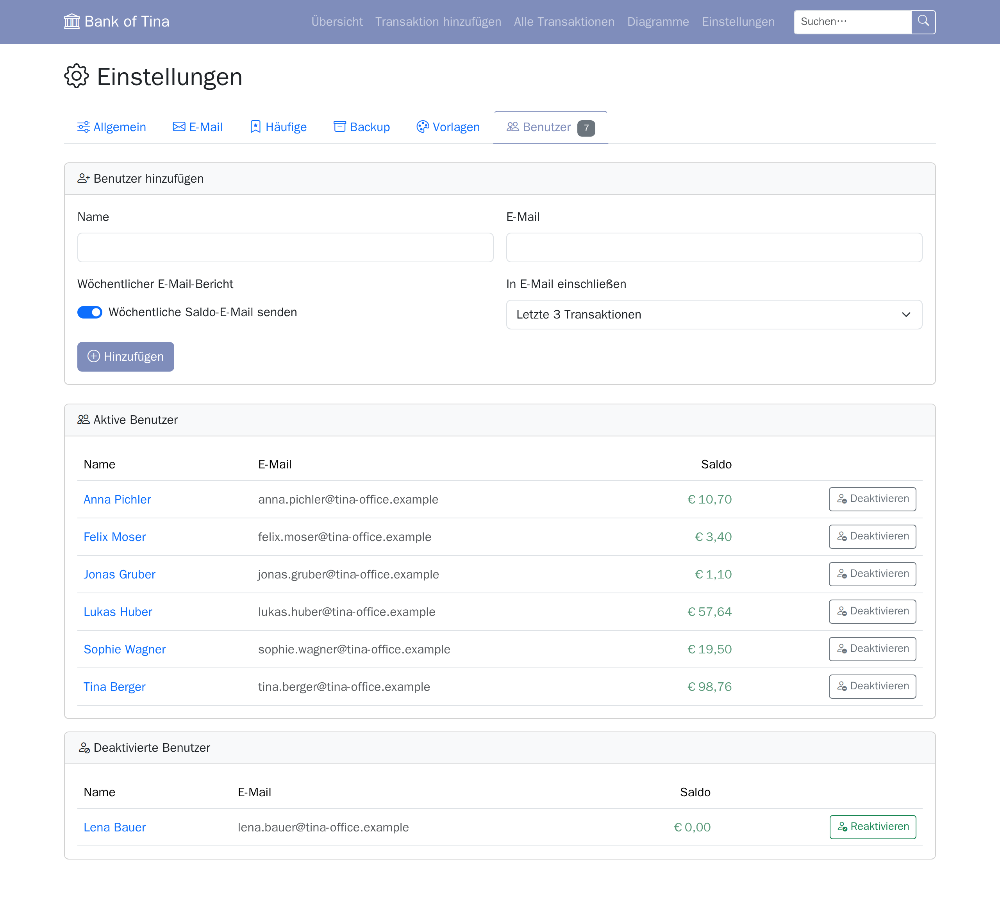

## Ausgabe erfassen
1. **Transaktion hinzufügen** → **Ausgabe**-Tab
2. Auswählen wer bezahlt hat
3. Beschreibung eingeben (optional: Beleg hochladen)
4. Artikelzeilen ausfüllen (vorausgefüllt basierend auf der Allgemein-Einstellung)
5. **Ausgabe erfassen**

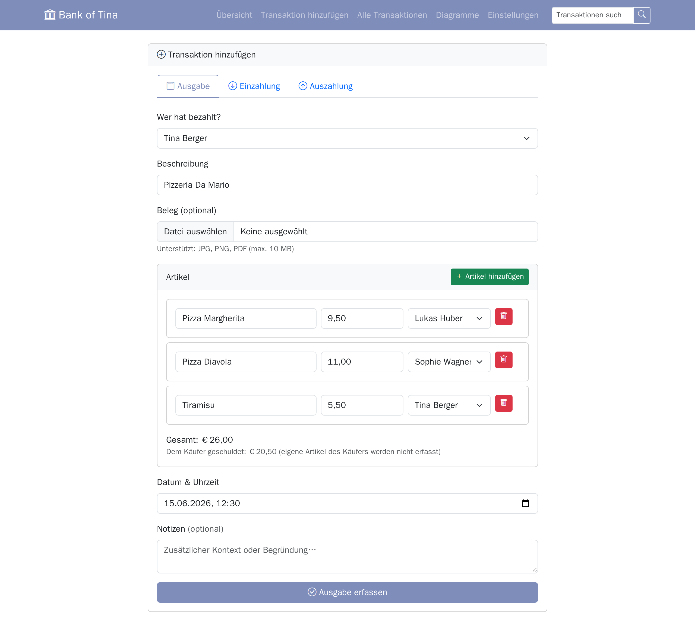

## Einzahlung oder Auszahlung erfassen
1. **Transaktion hinzufügen** → **Einzahlung**- oder **Auszahlung**-Tab (oder **Geld einzahlen** / **Geld auszahlen** auf der Übersicht)
2. Benutzer und Betrag wählen, optional Beschreibung, Datum und Notizen
3. **Geld einzahlen** bzw. **Geld auszahlen** — der Saldo ändert sich sofort

## Transaktionen nach Monat durchblättern
1. **Alle Transaktionen** in der Navigation → zeigt standardmäßig den aktuellen Monat
2. Mit ◀ / ▶ einen Monat vor/zurück navigieren (▶ ist im aktuellen Monat deaktiviert)
3. Die **Monat**- und **Jahr**-Dropdowns verwenden um direkt zu einer vergangenen Periode zu springen

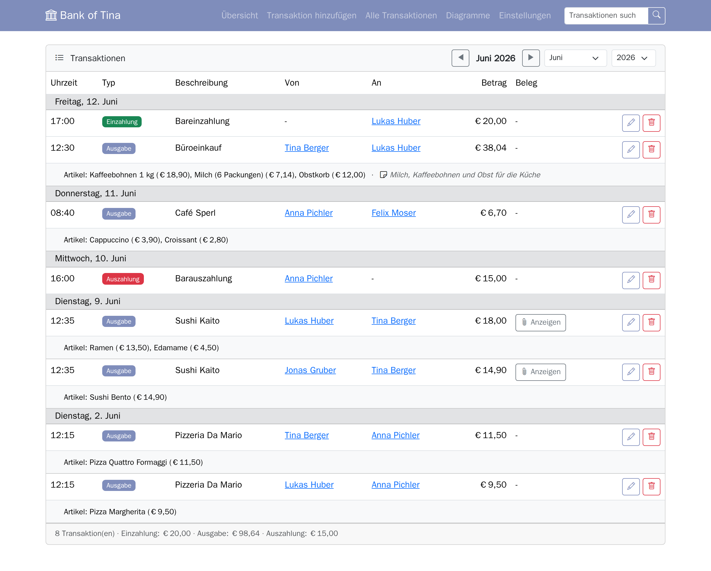

## Transaktionen suchen
1. Die Suchleiste in der Navigation (auf jeder Seite) für eine schnelle Stichwortsuche verwenden
2. Oder direkt zu `/search` navigieren für mehr Kontrolle
3. **Erweiterte Filter** klicken und kombinieren:
   - Typ, Benutzer, Datumsbereich, Betragsbereich
   - der Schalter **Hat Anhang / Beleg**
4. Ergebnisse erstrecken sich über alle Monate und zeigen das vollständige Datum (`JJJJ-MM-TT HH:MM`)

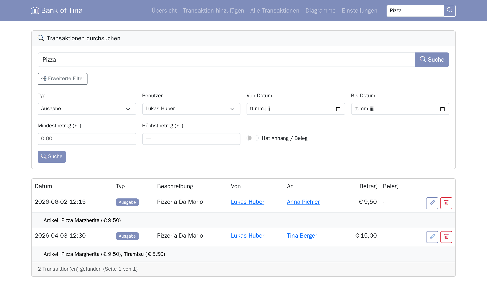

## Transaktion bearbeiten
1. **Alle Transaktionen** (oder Benutzerdetailseite) → Stift-Symbol
2. Beliebiges Feld anpassen — Beschreibung, Betrag, Datum, Von/An-Benutzer
3. Ausgabenpositionen hinzufügen, bearbeiten oder entfernen (die Summe aktualisiert das Betragsfeld automatisch)
4. Neuen Beleg hochladen, bestehenden ersetzen oder **Beleg entfernen** ankreuzen zum Löschen
5. **Änderungen speichern** — Salden werden automatisch neu berechnet

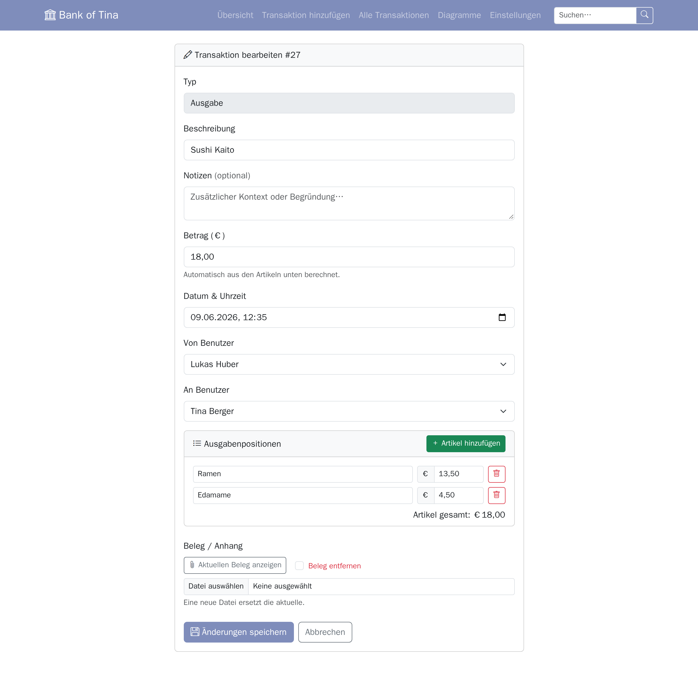

## Transaktion löschen
- Papierkorb-Symbol auf jeder Transaktionszeile — Salden werden automatisch zurückgesetzt

## E-Mail einrichten
1. **Einstellungen** → **E-Mail**-Tab
2. SMTP-Zugangsdaten eingeben und **Einstellungen speichern** klicken. **EHLO-Name** ist optional (leer: die Domain der Absender-E-Mail); mit einer **Seiten-URL** (der öffentlichen Adresse der App) trägt die wöchentliche Mail einen Abbestell-Link
3. **E-Mails jetzt senden** zum Testen verwenden, oder unter **Automatischer Zeitplan** einen wiederkehrenden Zeitplan einrichten
4. Optional **Admin-Zusammenfassungs-E-Mail senden** aktivieren — erfordert dass zuerst ein Seiten-Admin im Allgemein-Tab eingestellt wird

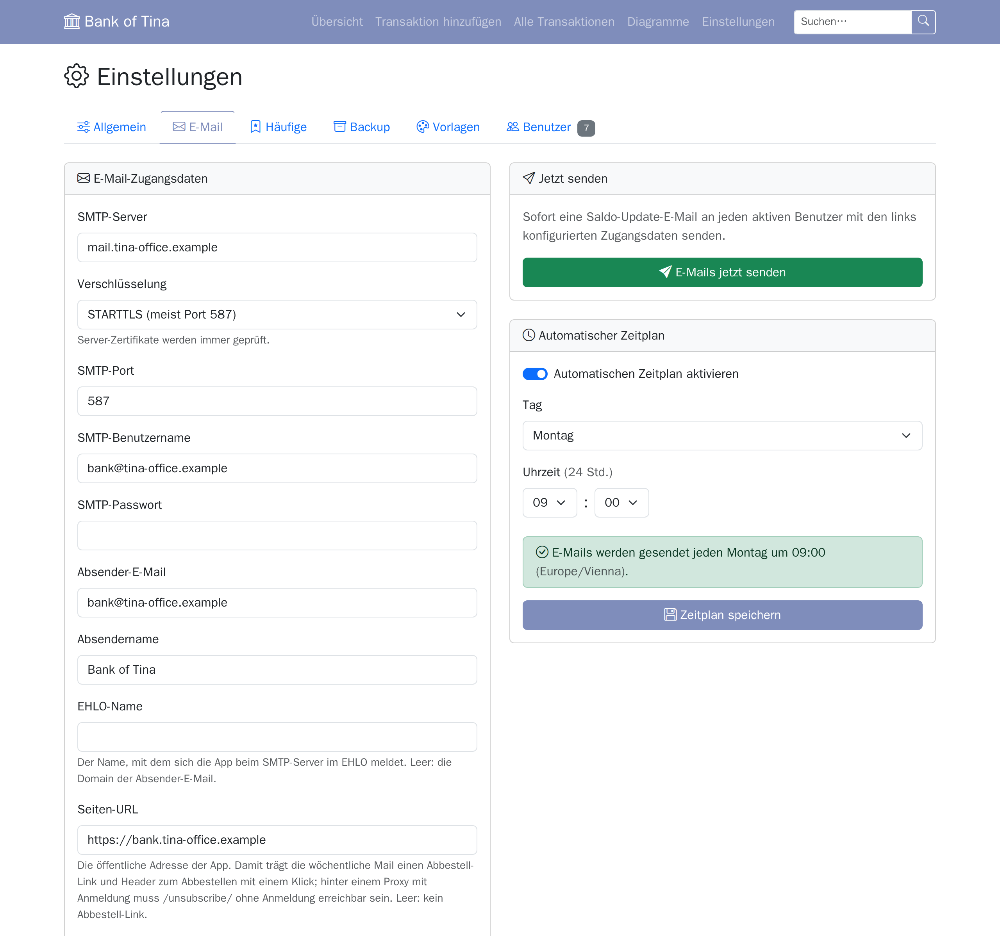

## E-Mail-Vorlagen anpassen
1. **Einstellungen** → **Vorlagen**-Tab
2. Ein Farb-Preset wählen oder einzelne Farbwähler anpassen
3. Betreff und Text für jeden E-Mail-Typ bearbeiten; Platzhalter wie `[Name]`, `[Balance]`, `[Date]` verwenden
4. **Vorschau** klicken um die gerenderte E-Mail in einem neuen Tab vor dem Speichern zu öffnen
5. **Vorlagen speichern** — Änderungen werden beim nächsten Versand wirksam

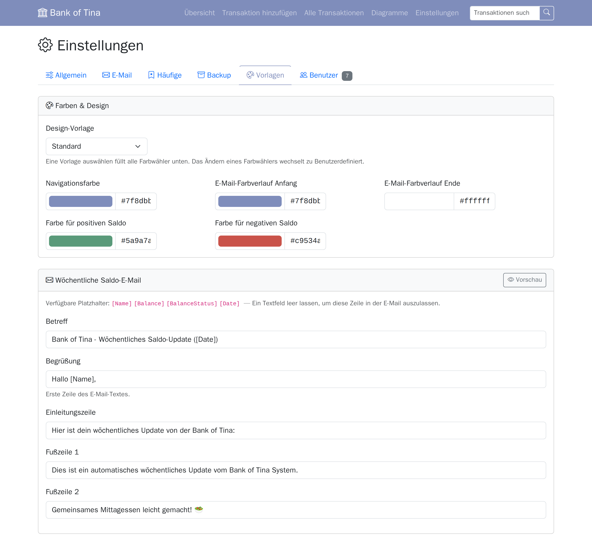

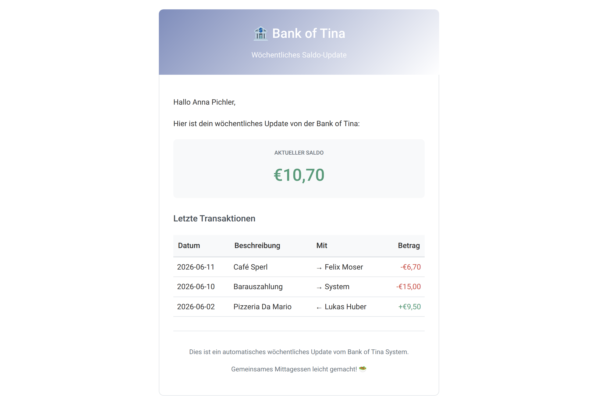

## Backup erstellen
1. **Einstellungen** → **Backup**-Tab → **Jetzt Backup erstellen**
2. Das Backup erscheint sofort in der Liste — **Herunterladen** klicken um es lokal zu speichern
3. Für automatische Backups **Automatischer Backup-Zeitplan** aktivieren, Tag/Uhrzeit und Anzahl der aufzubewahrenden Backups wählen, dann **Zeitplan speichern**

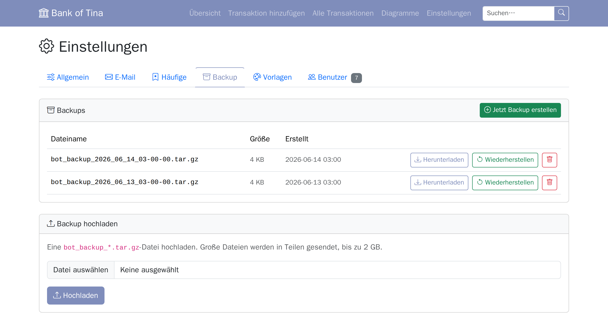

## Backup wiederherstellen
- **Aus der Liste**: **Wiederherstellen** neben einem bestehenden Backup klicken und bestätigen
- **Aus einer Datei**: im Bereich **Backup hochladen** eine `bot_backup_*.tar.gz`-Datei auswählen und **Hochladen** klicken
  - die Datei wird in Blöcken hochgeladen (bis 2 GB)
  - danach steht sie in der Liste, bereit zur Wiederherstellung

## Benutzer verwalten
1. **Einstellungen** → **Benutzer**-Tab
2. Aktive Benutzer stehen in der Liste **Aktive Benutzer**, deaktivierte in einer eigenen Liste **Deaktivierte Benutzer** (ausgeblendet, solange es keine gibt)
3. **Deaktivieren** klicken um einen Benutzer in die deaktivierte Liste zu verschieben, oder **Reaktivieren** um ihn in die aktive Liste zurückzuholen
4. Auf den Namen eines Benutzers klicken um seine Detailseite zu öffnen, dann **Benutzer bearbeiten** um Name, E-Mail, Mitglied-seit-Datum oder E-Mail-Einstellungen zu ändern

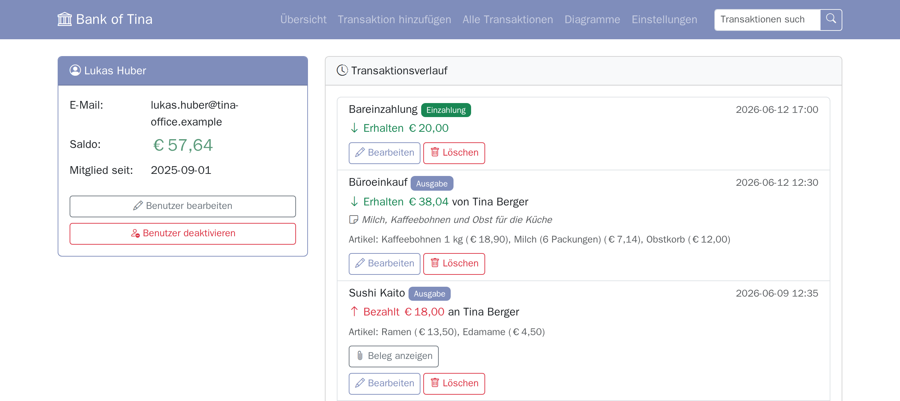

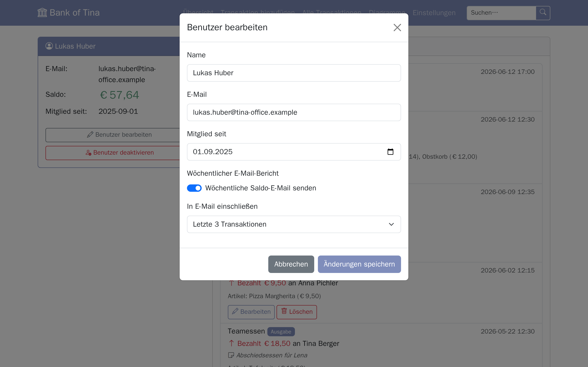

## Sprache wechseln
1. **Einstellungen** → **Allgemein**-Tab → **Sprache**-Dropdown
2. **Deutsch** oder **English** wählen
3. **Speichern** — die gesamte Oberfläche wechselt sofort zur gewählten Sprache

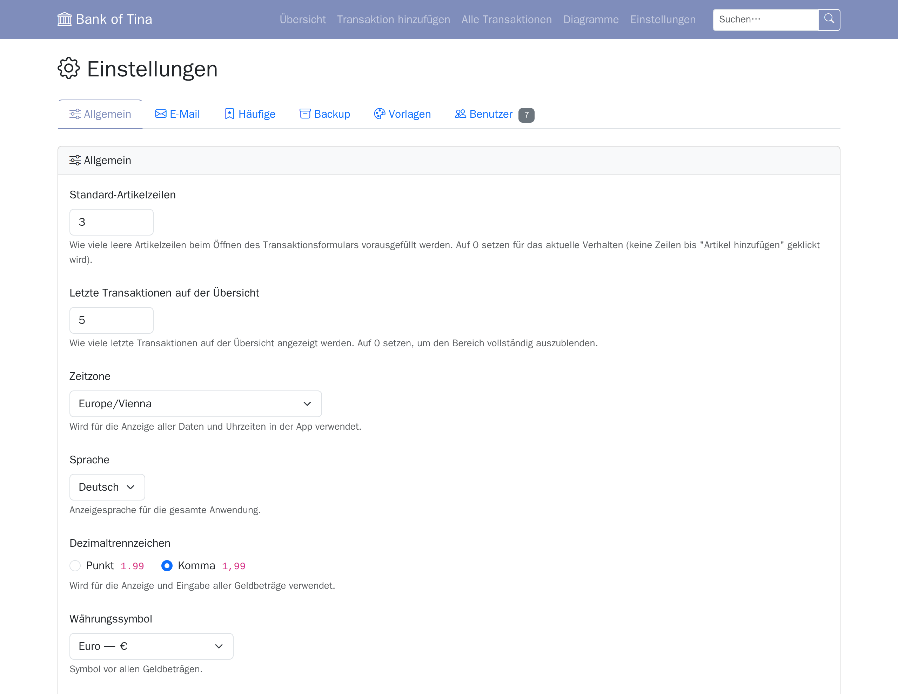

## Einstellungen im Überblick

Alles wird in der Web-UI eingestellt, kein `.env`-Bearbeiten nötig. Die Einstellungsseite ist in sechs Tabs aufgeteilt:

| Tab | Was konfiguriert wird |
|-----|----------------------|
| **Allgemein** | Standard-Artikelzeilen im Transaktionsformular; Anzahl letzter Transaktionen auf der Übersicht (0 blendet den Bereich aus); Zeitzone; **Sprache** (Deutsch/Englisch); **Dezimaltrennzeichen** (Punkt `1.99` oder Komma `1,99`); **Währungssymbol** (€, $, £, ¥ und mehr); E-Mail-Spalte auf der Übersicht ein-/ausblenden; Seiten-Admin |
| **E-Mail** | SMTP-Zugangsdaten und **Verschlüsselung** (STARTTLS / SSL/TLS / keine); EHLO-Name; Seiten-URL für den Abbestell-Link; E-Mail-Versand aktivieren/deaktivieren; Debug-Modus; Admin-Zusammenfassungs-E-Mail-Schalter; Saldo-E-Mails auf Abruf senden; wiederkehrenden Zeitplan einrichten |
| **Häufige** | Globaler Autovervollständigungsschalter; Artikelnamen, Beschreibungen und Preise manuell verwalten (jeweils mit eigener Blacklist); Auto-Sammlungs-Job konfigurieren und Debug-Log anzeigen |
| **Backup** | Backups erstellen/herunterladen/löschen; aus jedem Backup oder einer hochgeladenen Datei wiederherstellen; automatischen Backup-Zeitplan mit Auto-Bereinigung konfigurieren; Backup-Status-E-Mail an Seiten-Admin; Debug-Log |
| **Vorlagen** | Farbpalette + vordefinierte Designs; bearbeitbare Betreffs und Texte für alle drei E-Mail-Typen; Vorschau-Buttons; **App-Icon**-Karte — Icons aus Navigationsfarbe generieren, benutzerdefiniertes Icon hochladen oder auf Standard zurücksetzen |
| **Benutzer** | Neue Benutzer hinzufügen (inkl. E-Mail-Opt-in und Transaktionsumfang); aktive und deaktivierte Benutzer in getrennten Listen (deaktivierte Liste ist ausgeblendet wenn leer); Benutzer deaktivieren oder reaktivieren |

## Betrieb & Wartung

### MariaDB-Upgrade
Der `db`-Service setzt `MARIADB_AUTO_UPGRADE=1`: Beim ersten Start mit einer neueren Major-Version wird `mariadb-data/` automatisch aktualisiert. Vorher ein Backup erstellen (**Einstellungen** → **Backup** oder `docker compose exec db mariadb-dump ...`) — ein Major-Upgrade lässt sich nicht zurückrollen.

### Health-Check
```bash
curl http://localhost:5000/health
# Gibt strukturiertes JSON mit einzelnen Prüfergebnissen zurück:
# {"status": "ok", "checks": {"database": "ok", "scheduler": "ok", "icons_writable": "ok"}}
# Gibt 503 mit "status": "error" zurück wenn die Datenbank nicht erreichbar ist
```

Die `HEALTHCHECK`-Anweisung im Dockerfile ruft `/health` auf; der `web`-Service in `docker-compose.yml` übernimmt sie.

### Logs anzeigen
```bash
docker compose logs -f web    # Strukturierte Log-Ausgabe (Zeitstempel, Level, Modul, Nachricht)
docker compose logs -f db
```

`LOG_LEVEL`-Umgebungsvariable setzen um die Ausführlichkeit zu steuern (`DEBUG`, `INFO`, `WARNING`, `ERROR`). Standard ist `INFO`.

### Backup & Wiederherstellung
Den eingebauten **Einstellungen → Backup**-Tab für das Erstellen, Herunterladen, Hochladen und Wiederherstellen von Backups verwenden.

Für einen manuellen reinen Datenbank-Dump (die Variablen werden im `db`-Container aufgelöst):
```bash
docker compose exec db sh -c 'mariadb-dump -u "$MYSQL_USER" -p"$MYSQL_PASSWORD" "$MYSQL_DATABASE"' > backup_$(date +%Y%m%d).sql
```

### Nach Code-Änderungen aktualisieren
```bash
docker compose build && docker compose up -d
```

### Alles zurücksetzen ⚠️ (löscht alle Daten)
```bash
docker compose down
rm -rf mariadb-data/ uploads/*/ icons/
docker compose up -d
```

## Fehlerbehebung

| Problem | Schritte |
|---------|----------|
| E-Mails werden nicht gesendet | Einstellungen → E-Mail prüfen; SMTP-Zugangsdaten verifizieren; Logs prüfen |
| Beleg-Upload schlägt fehl | `chmod 755 uploads/` prüfen; verifizieren dass die Datei JPG/PNG/PDF ist |
| Port 5000 belegt | Host-Port in `docker-compose.yml` ändern (`"${BIND_ADDRESS:-127.0.0.1}:8080:5000"`) |
| App von anderen Rechnern nicht erreichbar | Port ist standardmäßig nur auf `127.0.0.1` veröffentlicht — Reverse-Proxy verwenden oder `BIND_ADDRESS=0.0.0.0` setzen (siehe [Schnellstart](../README.md#zugriff-von-anderen-rechnern)) |
| Web-Container startet nicht | `docker compose logs web` — die App wiederholt DB-Verbindungen bis zu 5 Mal mit exponentiellem Backoff beim Start; db-Logs prüfen wenn alle Versuche fehlschlagen |
| DB-Verbindung abgelehnt | Sicherstellen dass `mariadb-data/` beschreibbar ist; `docker compose restart db` |
