# 📱 Bank of Tina — Usage Guide

The common tasks step by step, every Settings tab at a glance, operations, maintenance and troubleshooting. Installation and feature overview: [README](../README.md#-english). [Deutsche Fassung](manual.de.md).

**Contents:** [Adding Users](#adding-users) · [Recording an Expense](#recording-an-expense) · [Deposit or Withdrawal](#recording-a-deposit-or-withdrawal) · [Browsing by Month](#browsing-transactions-by-month) · [Searching](#searching-transactions) · [Editing](#editing-a-transaction) · [Deleting](#deleting-a-transaction) · [Setting Up Email](#setting-up-email) · [Email Templates](#customising-email-templates) · [Creating a Backup](#creating-a-backup) · [Restoring a Backup](#restoring-a-backup) · [Managing Users](#managing-users) · [Switching Language](#switching-language) · [Settings at a Glance](#settings-at-a-glance) · [Operations & Maintenance](#operations--maintenance) · [Troubleshooting](#troubleshooting)

## Adding Users
1. **Settings** → **Users** tab → fill in name and email
2. Set **Weekly email report** (toggle on/off) and **Include in email** (transaction scope)
3. **Add**

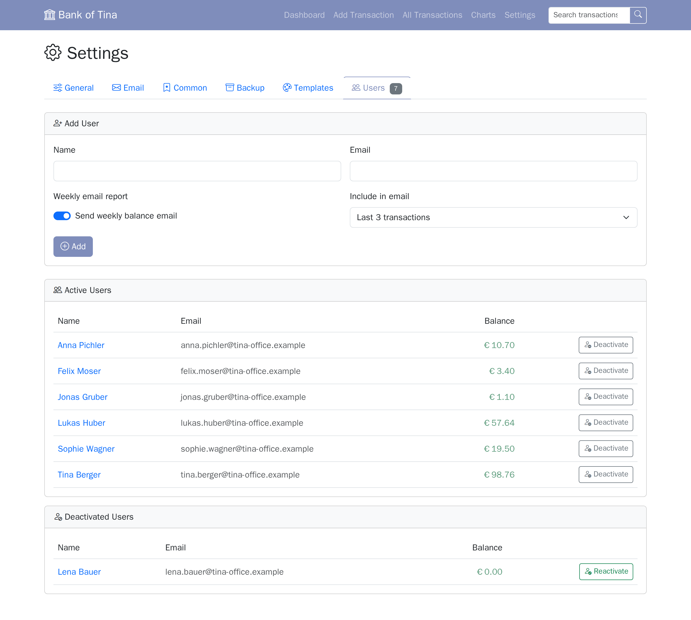

## Recording an Expense
1. **Add Transaction** → **Expense** tab
2. Select who paid
3. Enter a description (optional: upload a receipt)
4. Fill in item rows (pre-filled based on your General setting)
5. **Record Expense**

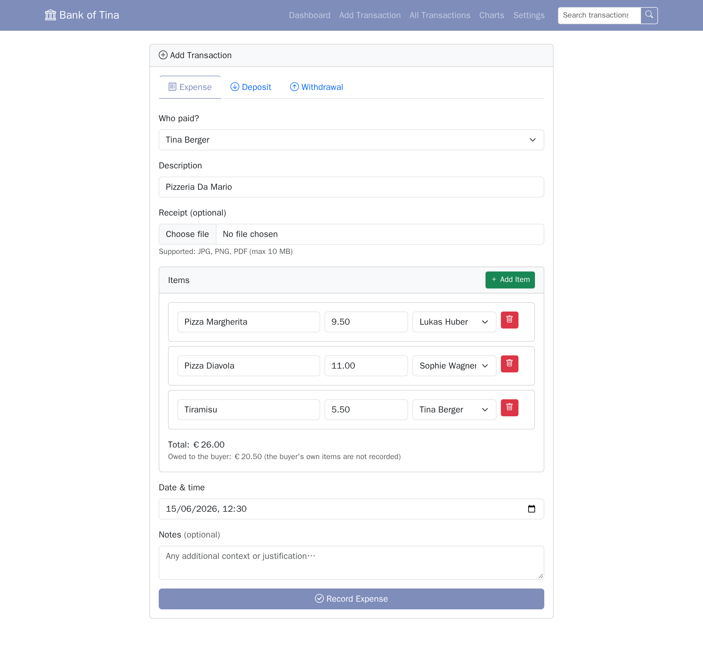

## Recording a Deposit or Withdrawal
1. **Add Transaction** → **Deposit** or **Withdrawal** tab (or **Add Money** / **Withdraw Money** on the dashboard)
2. Pick the user and the amount; description, date and notes are optional
3. **Add Money** or **Withdraw Money** — the balance changes immediately

## Browsing Transactions by Month
1. **All Transactions** in the nav → defaults to the current month
2. Use ◀ / ▶ to move one month at a time (▶ is disabled on the current month)
3. Use the **Month** and **Year** dropdowns to jump directly to any past period

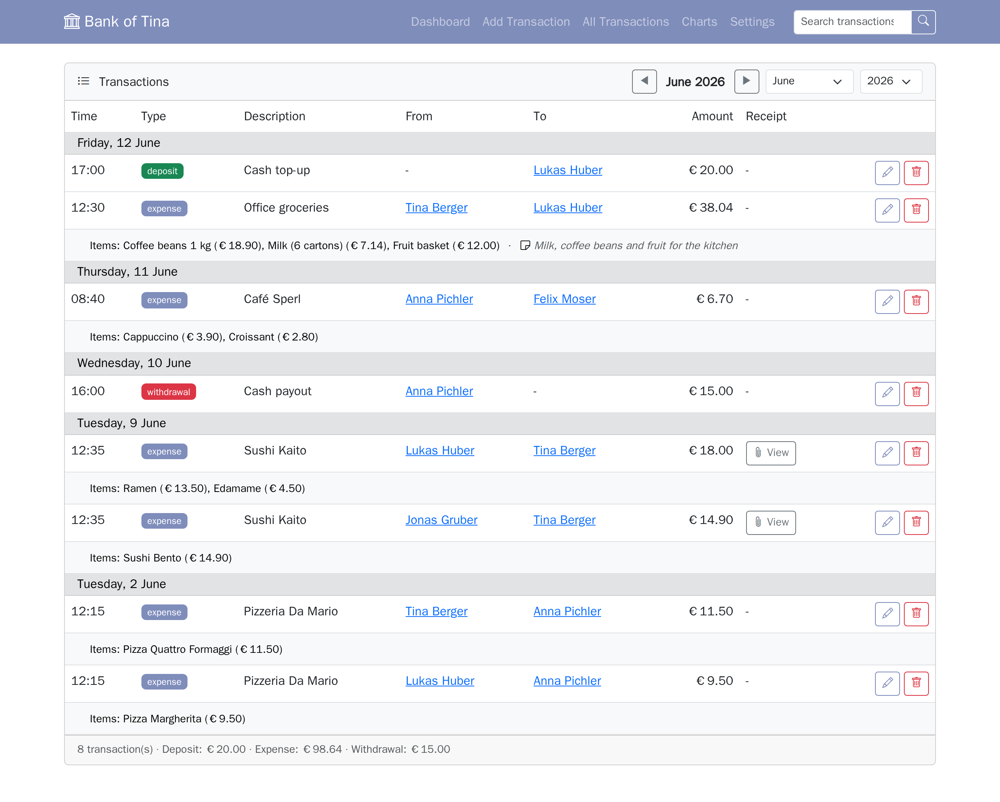

## Searching Transactions
1. Use the search bar in the navbar (any page) for a quick keyword search
2. Or navigate to `/search` directly for more control
3. Click **Advanced filters** and combine any of them:
   - type, user, date range, amount range
   - the **Has attachment / receipt** toggle
4. Results span all months and show the full date (`YYYY-MM-DD HH:MM`)

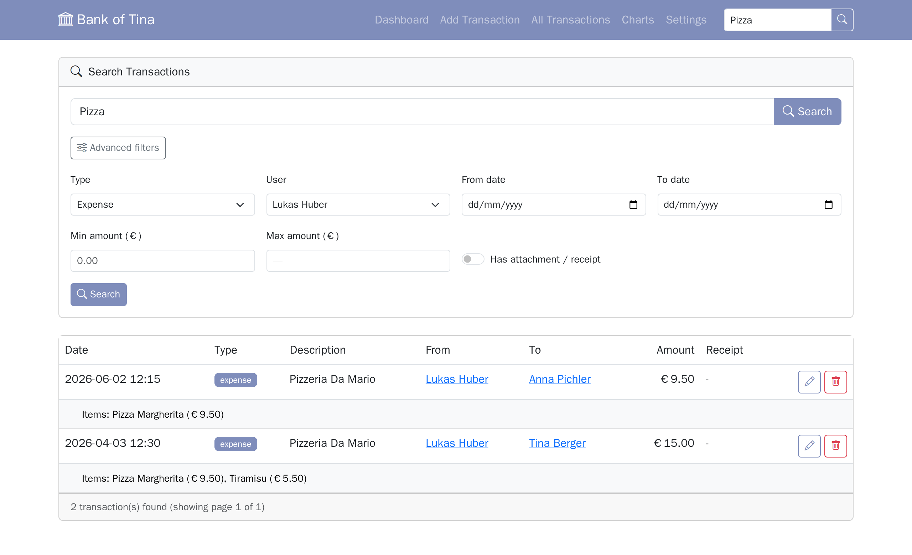

## Editing a Transaction
1. **All Transactions** (or a user's detail page) → pencil icon
2. Adjust any field — description, amount, date, from/to user
3. Add, edit, or remove expense items (the total auto-updates the Amount field)
4. Upload a new receipt, replace an existing one, or tick **Remove receipt** to delete it
5. **Save Changes** — balances are recalculated automatically

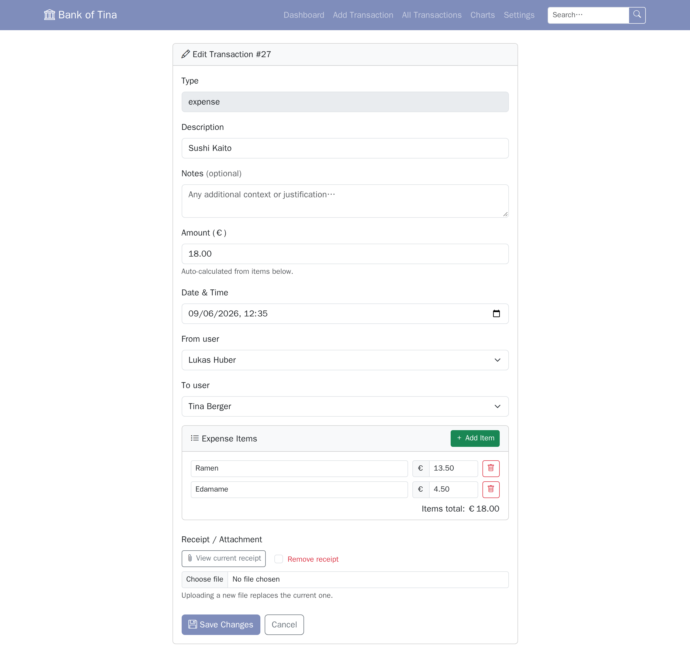

## Deleting a Transaction
- Trash icon on any transaction row — balances are reversed automatically

## Setting Up Email
1. **Settings** → **Email** tab
2. Fill in SMTP credentials and click **Save Settings**. **EHLO Name** is optional (empty: the domain of the From Email); with a **Site URL** (the app's public address) the weekly email carries an unsubscribe link
3. Use **Send Emails Now** to test, or configure a recurring schedule under **Auto-Schedule**
4. Optionally enable **Send admin summary email** — requires a site admin to be set in the General tab first

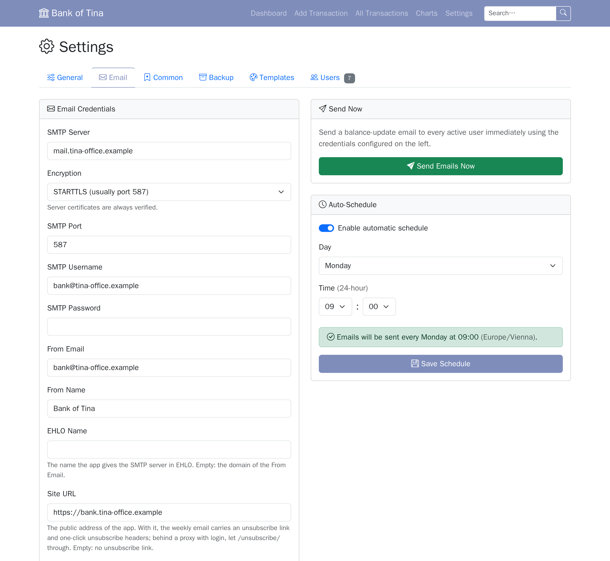

## Customising Email Templates
1. **Settings** → **Templates** tab
2. Pick a colour preset or adjust individual colour pickers
3. Edit the subject and body text for each email type; use placeholders like `[Name]`, `[Balance]`, `[Date]`
4. Click **Preview** to open the rendered email in a new tab before saving
5. **Save Templates** — changes take effect on the next send

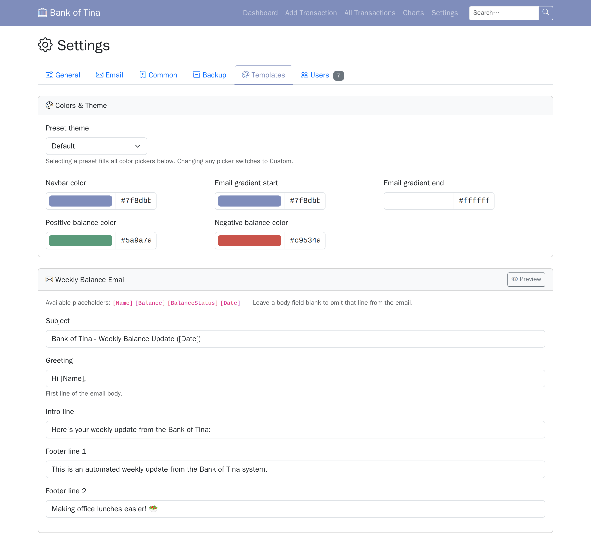

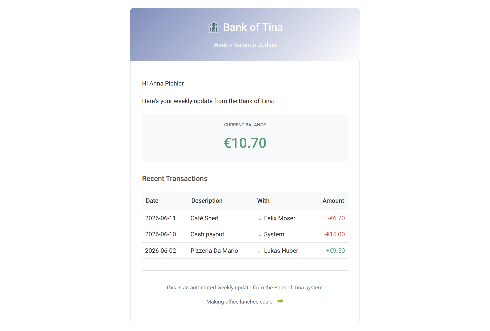

## Creating a Backup
1. **Settings** → **Backup** tab → **Create Backup Now**
2. The backup appears in the list instantly — click **Download** to save it locally
3. To schedule automatic backups, enable **Auto-Backup Schedule**, pick a day/time and how many backups to keep, then **Save Schedule**

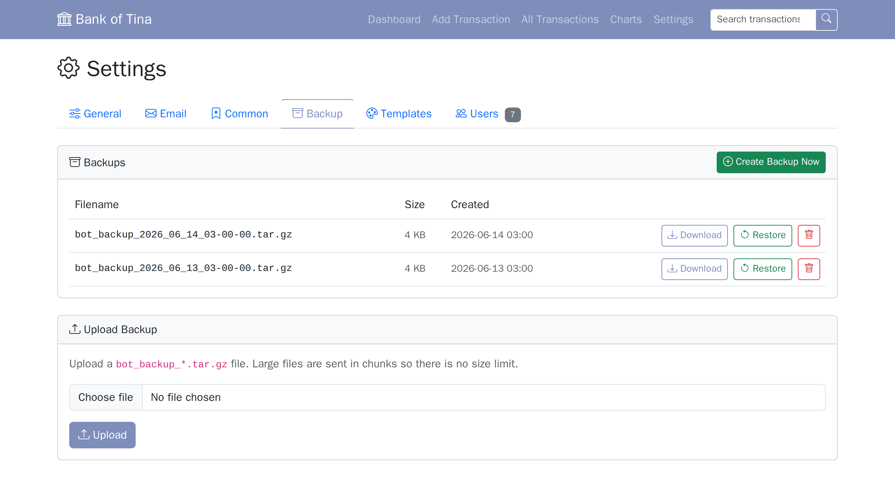

## Restoring a Backup
- **From the list**: click **Restore** next to any existing backup and confirm
- **From a file**: in the **Upload Backup** section, select a `bot_backup_*.tar.gz` file and click **Upload**
  - the file is uploaded in chunks (up to 2 GB)
  - when done it appears in the list, ready to restore

## Managing Users
1. **Settings** → **Users** tab
2. Active users are shown in an **Active Users** list; deactivated users appear in a separate **Deactivated Users** list (hidden when no deactivated users exist)
3. Click **Deactivate** to move a user to the deactivated list, or **Reactivate** to restore them to the active list
4. Click a user's name to open their detail page, then **Edit User** to change their name, email, member-since date, or email preferences

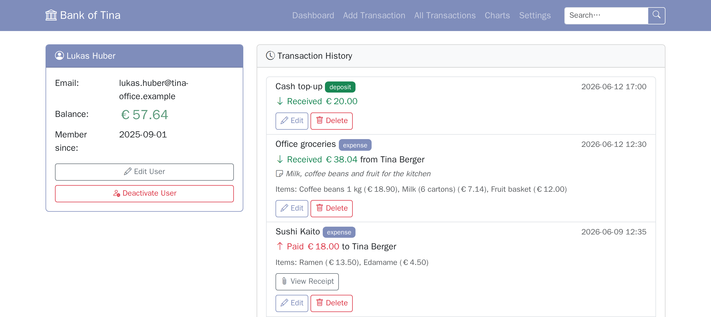

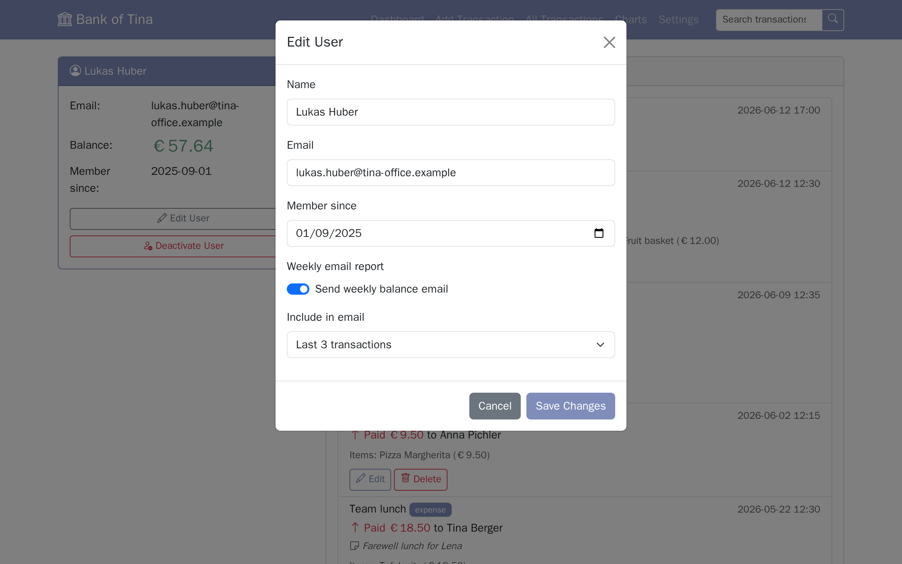

## Switching Language
1. **Settings** → **General** tab → **Language** dropdown
2. Select **Deutsch** or **English**
3. **Save** — the entire UI switches to the selected language immediately

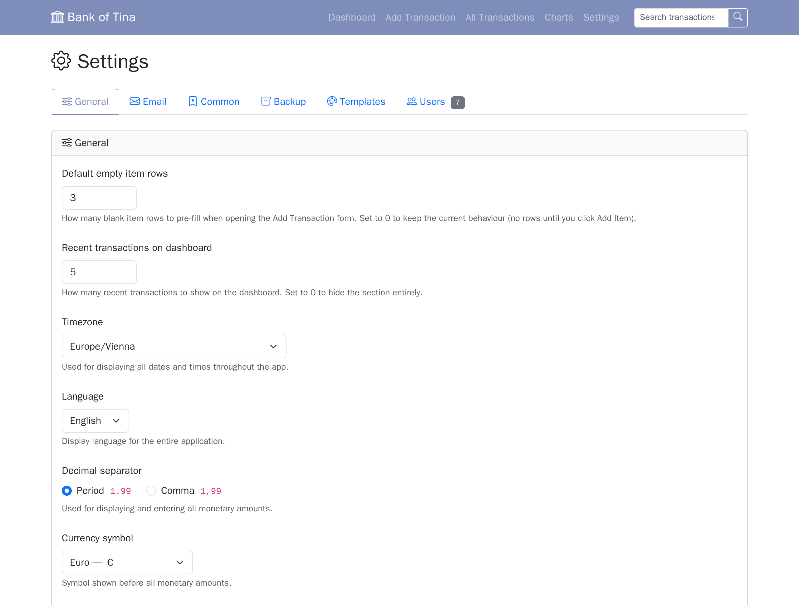

## Settings at a Glance

Everything is configured in the web UI; no `.env` editing needed. The Settings page is split into six tabs:

| Tab | What you configure |
|-----|--------------------|
| **General** | Default number of blank item rows in the Add Transaction form; number of recent transactions shown on the dashboard (0 hides the section); timezone; **language** (German/English); **decimal separator** (period `1.99` or comma `1,99`) applied to all monetary display and input throughout the app; **currency symbol** (€, $, £, ¥, and more) shown before all monetary amounts throughout the UI, charts, and emails; toggle to show/hide the email column on the dashboard; site admin (used for admin summary emails) |
| **Email** | SMTP credentials and **encryption** (STARTTLS / SSL/TLS / none); EHLO name; site URL for the unsubscribe link; enable/disable email sending; debug mode (logs runs to DB, surfaces SMTP errors in the UI); admin summary email toggle; send balance emails on demand; set a recurring auto-schedule |
| **Common** | Global autocomplete toggle; manually manage item names, descriptions, and prices (each with its own blacklist); configure the auto-collect scheduled job and view its debug log |
| **Backup** | Create/download/delete backups; restore from any backup or an uploaded file; configure an automatic backup schedule with auto-prune; backup status email to site admin (scheduled runs only); debug log |
| **Templates** | Color palette + preset themes; editable subjects and body text for all three email types (balance, admin summary, backup status); preview buttons for each email; **App Icon** card — regenerate icons from navbar color, upload a custom icon, or reset to default |
| **Users** | Add new users (including email opt-in and transaction scope preferences); active users and deactivated users are shown in separate lists (the deactivated list is hidden when empty); deactivate or reactivate any user |

## Operations & Maintenance

### MariaDB upgrades
The `db` service sets `MARIADB_AUTO_UPGRADE=1`, so the container upgrades `mariadb-data/` in place on its first start with a newer major version. Take a backup first (**Settings** → **Backup**, or `docker compose exec db mariadb-dump ...`) — a major-version upgrade cannot be rolled back.

### Health check
```bash
curl http://localhost:5000/health
# Returns structured JSON with individual check results:
# {"status": "ok", "checks": {"database": "ok", "scheduler": "ok", "icons_writable": "ok"}}
# Returns 503 with "status": "error" when the database is unreachable
```

The Dockerfile's `HEALTHCHECK` calls `/health`; the `web` service in `docker-compose.yml` inherits it.

### View logs
```bash
docker compose logs -f web    # Structured log output (timestamp, level, module, message)
docker compose logs -f db
```

Set the `LOG_LEVEL` environment variable to control verbosity (`DEBUG`, `INFO`, `WARNING`, `ERROR`). Default is `INFO`.

### Backup & restore
Use the built-in **Settings → Backup** tab for creating, downloading, uploading, and restoring backups.

For a manual database-only dump (the variables are resolved inside the `db` container):
```bash
docker compose exec db sh -c 'mariadb-dump -u "$MYSQL_USER" -p"$MYSQL_PASSWORD" "$MYSQL_DATABASE"' > backup_$(date +%Y%m%d).sql
```

### Update after code changes
```bash
docker compose build && docker compose up -d
```

### Reset everything ⚠️ (deletes all data)
```bash
docker compose down
rm -rf mariadb-data/ uploads/*/ icons/
docker compose up -d
```

## Troubleshooting

| Problem | Steps |
|---------|-------|
| Emails not sending | Check Settings → Email; verify SMTP credentials; check logs |
| Receipt upload fails | Check `chmod 755 uploads/`; verify file is JPG/PNG/PDF |
| Port 5000 in use | Change the host port in `docker-compose.yml` (`"${BIND_ADDRESS:-127.0.0.1}:8080:5000"`) |
| App not reachable from other machines | The port is published on `127.0.0.1` by default — use a reverse proxy or set `BIND_ADDRESS=0.0.0.0` (see [Quick Start](../README.md#access-from-other-machines)) |
| Web container won't start | `docker compose logs web` — the app retries DB connections up to 5 times with exponential backoff on startup; check db logs if all retries fail |
| DB connection refused | Ensure `mariadb-data/` is writable; `docker compose restart db` |
